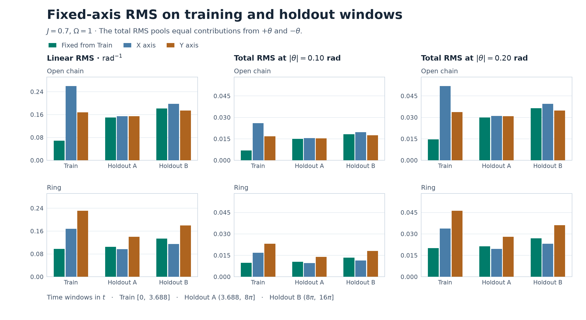
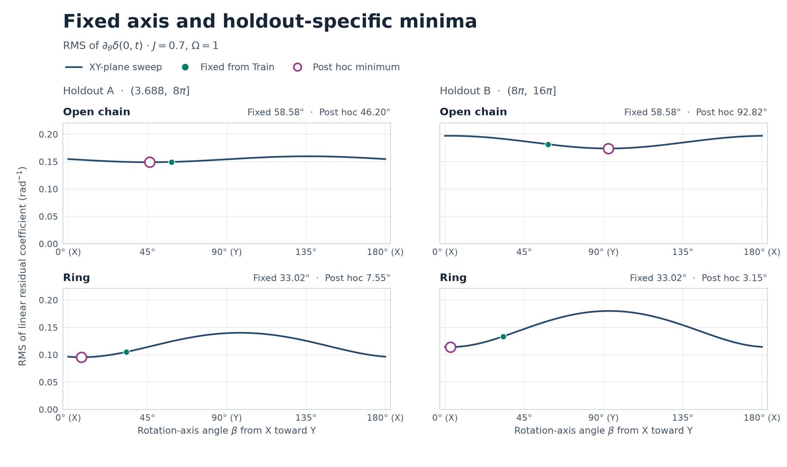

# 短窓で決めた回転軸の時間外検証

短窓の固定軸は、時間外では**直線の窓Aでのみ、X・Y の良い方を上回った**。直線の窓Bと輪の両時間外窓では下回った。この勝敗は、角度一次係数、有限角 \(\theta=\pm0.10,\pm0.20\) の各符号の総残差、正負を統合した総残差で一致した。

## 条件と評価方法

\(N=4,\Omega=1,J=0.7\)、初期状態 \(A=|1000\rangle\)。前回と同じ横磁場イジング・ハミルトニアンで、サイト0を XY 平面内の軸で回転させた。X から Y に向けて測った固定軸角は、直線 \(58.58380869173219^\circ\)、輪 \(33.01540214916281^\circ\)。前回の CSV の \(J=0.7\)、短窓の行から全精度値を読み込み、3区間の評価にそのまま使った。比較軸は X（\(0^\circ\)）と Y（\(90^\circ\)）。 [前回の最適化](../antiphase-axis-optimization-2026-11-10/REPORT.md) · [固定軸の出典 CSV](../antiphase-axis-optimization-2026-11-10/optima.csv)

| 区間 | 時間 |
|:---|:---|
| 訓練 | \(0\le t\le3.688\) |
| 時間外A | \(3.688<t\le8\pi\) |
| 時間外B | \(8\pi<t\le16\pi\) |

残差は直線 \(\delta=R_0+R_3-1\)、輪 \(\delta=R_0+R_2-1\)。各窓の時間平均は窓長で正規化し、\(\mathrm{RMS}(f)=\sqrt{\langle f^2\rangle}\) とした。改善率は各指標・各窓で \(1-\mathrm{RMS}_{\rm fixed}/\min(\mathrm{RMS}_X,\mathrm{RMS}_Y)\)。正なら固定軸の方が小さい。

## 一次係数の時間外性能

| 接続・窓 | 固定軸 | X | Y | X・Yの良い方からの改善率 |
|:---|---:|---:|---:|---:|
| 直線・訓練 | **0.068484** | 0.259974 | 0.167793 | **+59.19%** |
| 直線・A | **0.149640** | 0.154855 | 0.154402 | **+3.08%** |
| 直線・B | 0.181878 | 0.197351 | **0.174280** | −4.36% |
| 輪・訓練 | **0.097438** | 0.167691 | 0.231534 | **+41.89%** |
| 輪・A | 0.105333 | **0.096585** | 0.139648 | −9.06% |
| 輪・B | 0.133724 | **0.114596** | 0.180024 | −16.69% |

直線の改善率は \(+59.19\%\to+3.08\%\to-4.36\%\)、輪は \(+41.89\%\to-9.06\%\to-16.69\%\) と推移した。固定軸は輪の時間外でも Y より小さいが、X を基準にすると両窓で劣る。直線Bでは Y より大きく、X より小さい。 [全軸の一次係数 RMS](linear.csv)

## 事後最適軸と regret

各窓の一次係数 RMS を最小にする事後軸を、固定軸の採点後に診断用として計算した。regret は固定軸 RMS から事後最小 RMS を引いた値。角度差は軸の \(180^\circ\) 周期を考慮した最短距離。

| 接続・窓 | 事後最適軸 | 事後最小 RMS | regret | 固定軸との角度差 |
|:---|---:|---:|---:|---:|
| 直線・訓練 | \(58.584^\circ\) | 0.068484 | 0 | \(0^\circ\) |
| 直線・A | \(46.202^\circ\) | 0.149126 | 0.000514 | \(12.382^\circ\) |
| 直線・B | \(92.818^\circ\) | 0.174220 | 0.007658 | \(34.234^\circ\) |
| 輪・訓練 | \(33.015^\circ\) | 0.097438 | 0 | \(0^\circ\) |
| 輪・A | \(7.548^\circ\) | 0.095639 | 0.009694 | \(25.467^\circ\) |
| 輪・B | \(3.151^\circ\) | 0.114340 | 0.019384 | \(29.864^\circ\) |

直線Aの固定軸は事後最小に近く、輪では両時間外窓で事後軸が X 寄りになった。直線Bでは X・Y の一次波形の積の平均 \(G_{XY}\) が \(+0.000423\) と正になった。訓練窓とAでは負だったため、同じ符号で X・Y 成分を混ぜる固定軸の交差項は、Bでは残差二乗を増やす側に回る。 [事後診断と正負統合の regret](regret.csv)

## 有限角の総残差

\(B=|0000\rangle\)、\(D=-(Z_0+Z_k)/2\)、\(D(t)=e^{itH}De^{-itH}\) とする。前回の補完関係により \(\langle A|D(t)|A\rangle=0\)。軸角 \(\beta\) の角度一次係数を \(L_\beta\)、\(b(t)=\langle B|D(t)|B\rangle\) とすると、正負角の残差を

\[
e(t)=\sin^2(\theta/2)b(t),\qquad o(t)=\sin\theta\,L_\beta(t),\qquad
\delta(\pm\theta,t)=e(t)\pm o(t)
\]

に分けられる。従って符号別の総残差の平均二乗は \(\langle e^2\rangle+\langle o^2\rangle\pm2\langle eo\rangle\)。正負統合は \(\sqrt{(\langle\delta(+\theta)^2\rangle+\langle\delta(-\theta)^2\rangle)/2}\) と定義し、交差項が相殺される。偶成分は軸によらないため、今回の非ゼロ角では、正負統合の軸順位は一次係数の順位と厳密に一致する。符号別には交差項が残るので、各符号について総残差を個別に評価した。

各セルは固定軸の総残差 RMS と、その指標での X・Y の良い方からの改善率。

| 接続・窓 | \(\lvert\theta\rvert\) (rad) | 正角 | 負角 | 正負統合 |
|:---|---:|---:|---:|---:|
| 直線・訓練 | 0.10 | 0.007936 (+52.67%) | 0.005855 (+65.25%) | 0.006973 (+58.51%) |
| 直線・訓練 | 0.20 | 0.018139 (+46.05%) | 0.010057 (+70.37%) | 0.014666 (+56.59%) |
| 直線・A | 0.10 | 0.014770 (+2.86%) | 0.015152 (+1.99%) | 0.014962 (+3.07%) |
| 直線・A | 0.20 | 0.029145 (+2.61%) | 0.030664 (+0.63%) | 0.029914 (+3.05%) |
| 直線・B | 0.10 | 0.017989 (−4.66%) | 0.018386 (−4.04%) | 0.018189 (−4.34%) |
| 直線・B | 0.20 | 0.035584 (−4.94%) | 0.037161 (−3.72%) | 0.036381 (−4.30%) |
| 輪・訓練 | 0.10 | 0.010587 (+40.31%) | 0.008955 (+43.25%) | 0.009805 (+41.59%) |
| 輪・訓練 | 0.20 | 0.022921 (+38.61%) | 0.016499 (+44.19%) | 0.019970 (+40.70%) |
| 輪・A | 0.10 | 0.010349 (−4.88%) | 0.010768 (−13.20%) | 0.010561 (−8.97%) |
| 輪・A | 0.20 | 0.020443 (−0.88%) | 0.022093 (−17.10%) | 0.021284 (−8.71%) |
| 輪・B | 0.10 | 0.012966 (−12.43%) | 0.013804 (−20.61%) | 0.013392 (−16.56%) |
| 輪・B | 0.20 | 0.025186 (−8.00%) | 0.028506 (−24.04%) | 0.026897 (−16.18%) |

全符号で固定軸の勝敗は一次係数と一致したが、改善幅は符号で異なる。直線Aの負角では、符号別総残差の基準が一次係数の Y から X に変わった。輪Aの \(+0.20\) は X より \(0.88\%\) 大きい一方、\(-0.20\) では \(17.10\%\) 大きい。無回転の残差は両接続で厳密にゼロ。 [全軸・全角度の総残差、偶奇 RMS、交差項](finite.csv)

## 振動振幅と残差の内訳

各サイトについて半レンジ \((\max R_i-\min R_i)/2\) と、窓平均まわりの時間標準偏差 \(\sigma_i\) を求めた。固定軸での全サイト・全非ゼロ角の半レンジは、同じサイト・窓の無回転値の **90.53〜106.98%**、時間標準偏差は **91.72〜105.71%**。増える条件もあり、占有率の振動は全窓で残った。 [サイト別の半レンジと時間標準偏差](sites.csv)

ペアの残差二乗は、窓平均の偏り、標準偏差の不一致、反相関からのずれの三つに分けた。ここで \(\rho\) は二つの占有率の時間 Pearson 相関。

\[
\langle\delta^2\rangle=(\langle R_0\rangle+\langle R_k\rangle-1)^2+
(\sigma_0-\sigma_k)^2+2\sigma_0\sigma_k(1+\rho).
\]

直線A・\(\theta=-0.20\) では、固定軸にすると X に比べてサイト0の半レンジは \(0.390853\to0.375597\) に下がり、サイト3は \(0.391741\) のまま。時間標準偏差はサイト0で \(0.166441\to0.158923\)、サイト3で \(0.166234\) のままで、ペア間の標準偏差の差は広がった。それでも \(\rho=-0.982847\to-0.983453\) と反相関が強まり、総残差は \(0.030858\to0.030664\) に下がった。

この例で反相関項の減少 \(7.49\times10^{-5}\) を二つの因子に分けると、標準偏差積の縮小による寄与が \(4.21\times10^{-5}\)、相関係数の改善による寄与が \(3.28\times10^{-5}\)。分解には \(\Delta(ab)=\bar a\,\Delta b+\bar b\,\Delta a\) を使った。他の二項は合わせて \(6.30\times10^{-5}\) 増えたので、振幅縮小の寄与だけでは増加を埋められない。正負統合で固定軸と Y を比べると、直線A・\(\lvert\theta\rvert=0.20\) では三つの寄与がそれぞれ \(1.48,2.20,2.03\)（単位 \(10^{-5}\)）減少した。 [各符号の残差二乗の内訳と相関係数](pair_moments.csv)

## 数値検証と再現

各窓の RMS、時間平均・標準偏差は、固有エネルギー差から連続時間で積分した。\([a,b]\) での \(e^{i\nu t}\) の平均は \(e^{i\nu(a+b)/2}\operatorname{sinc}(\nu(b-a)/2)\)。\(\operatorname{sinc}x=\sin(x)/x\) で、零周波数を含めた。窓の開閉は連続時間平均に影響しない。半レンジは約0.001刻みで窓の閉包をサンプルした値。下端が開いている場合の上限・下限も連続性により閉包の極値と等しい。

状態ベクトルの直接計算と台形積分でも照合し、一次係数の Gram 行列の要素は \(2.3\times10^{-9}\)、総残差 RMS は \(2.9\times10^{-9}\)、サイト標準偏差は \(6.2\times10^{-9}\) 以内で一致した。半レンジの約0.002刻みからの変化は \(2.2\times10^{-7}\) 以下。残差二乗の三項分解は \(8.2\times10^{-16}\) 以内で一致した。掃引曲線は \(0.25^\circ\) 刻みで保存し、診断軸は \(2\times2\) Gram 行列の固有ベクトルから求めた。判定は指定された3窓と回転角に対応する。 [検証誤差と軸の読み込み値](audit.json) · [時間外窓の軸掃引データ](sweep.csv)

プロジェクトのルートで、NumPy と Matplotlib を使って実行する。

~~~sh
python -B experiments/antiphase-axis-holdout-2026-11-10/run.py
python -B experiments/antiphase-axis-holdout-2026-11-10/plot.py
~~~
