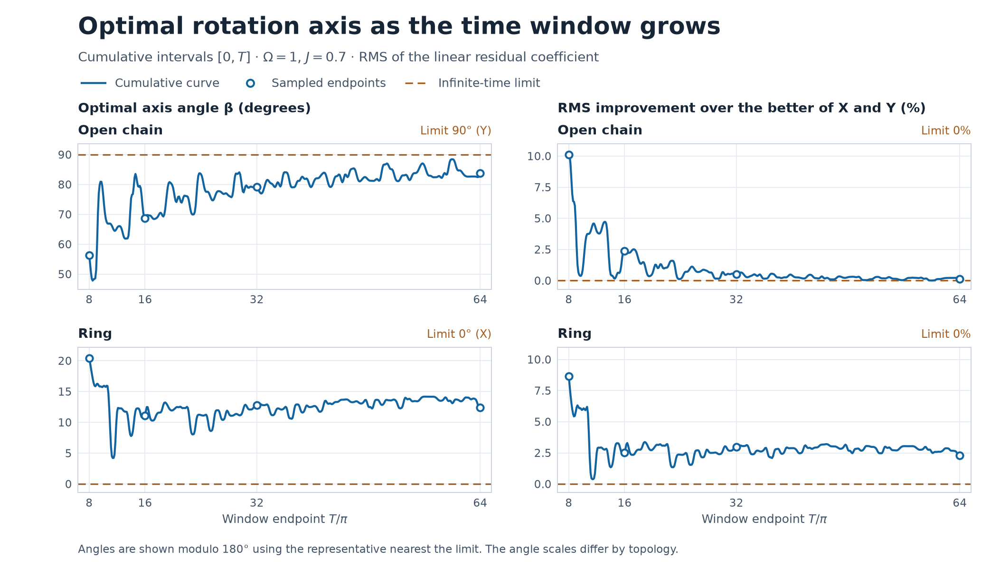

# 逆位相ペアの残差を抑える軸の時間依存性

短窓で最適化した回転軸の優位性は、指定した時間外区間を通しては持続しなかった。X・Y の良い方に対する一次係数 RMS の改善率は、直線で訓練窓 \(+59.19\%\)、時間外A \(+3.08\%\)、時間外B \(-4.36\%\)。輪では \(+41.89\%\)、\(-9.06\%\)、\(-16.69\%\) だった。ここで調べるのは、逆位相ペアの**占有率和の残差を抑える軸が、観測時間によってどう変わるか**である。 [前回の時間外検証](../antiphase-axis-holdout-2026-11-10/REPORT.md)

\(N=4,\Omega=1,J=0.7\)、初期状態 \(A=|1000\rangle\)、サイト0の XY 平面内の回転を使う。軸角 \(\beta\) は X から Y に向けて測る。残差は直線で \(\delta=R_0+R_3-1\)、輪で \(\delta=R_0+R_2-1\)。評価量は \(\left.\partial_\theta\delta\right|_{\theta=0}\) の時間 RMS。

## 長時間平均の最適軸

行列成分の順は X、Y。改善率は各窓で \(1-\mathrm{RMS}_{\min}/\min(\mathrm{RMS}_X,\mathrm{RMS}_Y)\) とした。

| 接続 | \(G_{\infty,XX}\) | \(G_{\infty,XY}\) | \(G_{\infty,YY}\) | 最適軸 | 最小 RMS | 改善率 |
|:---|---:|---:|---:|:---|---:|---:|
| 直線 | 0.032691791673 | 0（厳密） | 0.025944196291 | Y（\(90^\circ\)） | **0.161072022** | 0% |
| 輪 | 0.013911035299 | 0（厳密） | 0.024768418390 | X（\(0^\circ\)） | **0.117945052** | 0% |

極限の純 X・Y の RMS は直線で \(0.180808716,\,0.161072022\)、輪で \(0.117945052,\,0.157379854\)。両接続で長時間の最適軸は純軸の一方と一致した。 [極限の数値と固有値](limits.csv)

## 固有エネルギー差と周波数の相殺

\(B=|0000\rangle\)、\(S=Z_0+Z_k\)、\(C(t)=\langle A|e^{itH}S e^{-itH}|B\rangle\) とすると、一次係数は \(f_X(t)\cos\beta+f_Y(t)\sin\beta\)、ここで \(f_X=-\operatorname{Im}C/2\)、\(f_Y=\operatorname{Re}C/2\)。\(G(T)=T^{-1}\int_0^T f(t)f(t)^{\mathsf T}\,dt\) で \(f=(f_X,f_Y)^{\mathsf T}\)。\(C(t)\) をエネルギー差で展開し、同じ符号付きギャップを持つ項の係数を**足し合わせてから**、波形の積を時間平均する。

\(H\) と可換な全反転 \(P=\prod_j X_j\) に対し \(S\) は反可換なので、\(C\) に寄与できるのは異なる \(P\) 部門を結ぶ遷移。整数行列 \(K=20H\) の \(P=\pm1\) ブロックを \(K_\pm\) とすると、\(K_+\otimes I-I\otimes K_-\) の固有値が片方向のギャップを与える。その整数特性多項式はギャップ変数 \(g\) に関して偶で、定数項は非ゼロ。\(g^2\) の32次多項式とその導関数の最大公約数は、直線で12次、輪で17次。従って厳密に異なる正のギャップは直線で **20個**、輪で **15個**。数値固有値は有理数区間を置くために使い、ブロック固有値の個数と重複度を多項式の符号で確認した。ギャップの区間をまとめた個数が平方因子除去後の次数と一致するため、各グループには厳密に一つのギャップが入る。DC ギャップは存在しない。

直線では端点のマヨラナ恒等式 \(C=F_{02}+iF_{01}\) により、残る正周波数は \(iM\) の正の4モードに限られる。輪では半周回転 \(P_2=(02)(13)\) が \(H,S\) と可換で \(P_2B=B\) なので、\(P_2=-1\) の部分が消える。\(K_-\) の \(\pm20\) 固有空間は全て \(P_2=-1\) にあり、これを除くと輪で残る正周波数は10個。両接続の残った各モードの係数が非ゼロであることは、時間微分を表す整数モーメントから作る Hankel 行列の行列式を素数で剰余計算して確認した。 [前回の直線の演算子恒等式](../antiphase-xy-rotation-2026-11-10/REPORT.md) · [Pfeuty の横磁場イジング鎖の変換](https://www.math.ucdavis.edu/~bxn/pfeuty1970.pdf) · [グループごとの周波数と係数](spectral_modes.csv) · [整数演算による証明の記録](audit.json)

実数ハミルトニアンでは \(C(-t)=C(t)^*\) なので、グループ化後は \(f_X(t)=\sum_\nu x_\nu\sin(\omega_\nu t)\)、\(f_Y(t)=\sum_\nu y_\nu\cos(\omega_\nu t)\) と書ける。異なる周波数の積は長時間平均で消え、同じ周波数でも \(\sin\) と \(\cos\) の積の平均はゼロ。従って

\[
G_\infty=\frac12
\begin{pmatrix}
\sum_\nu x_\nu^2 & 0\\
0 & \sum_\nu y_\nu^2
\end{pmatrix}.
\]

対角成分は整数モーメントからも有理数として求めた。異なる平方ギャップを \(q_\nu=(20\omega_\nu)^2\)、Vandermonde 行列を \(V_{r\nu}=q_\nu^r\) とする。整数の偶モーメント列は \(4V y\)、奇モーメント列は \(-4V\operatorname{diag}(\sqrt{q_\nu})x\) になる。\(VV^{\mathsf T}\) と \(V\operatorname{diag}(q_\nu)V^{\mathsf T}\) を Newton 和で作って逆二次形式を取ると、係数二乗和を有理数で計算できる。対角成分の厳密値は

\[
\begin{aligned}
\text{直線}\quad &\left(\frac{318475}{9741742},\,\frac{758225}{29225226}\right),\\
\text{輪}\quad &\left(\frac{3290125}{236511872},\,\frac{5858025}{236511872}\right).
\end{aligned}
\]

倍精度の周波数展開から求めた値との差は \(2.8\times10^{-17}\) 以下。なお、同じギャップに属する項を個別に二乗すると、直線では対角成分が \((0.016674,0.017917)\) となり、最適軸まで逆に判定してしまう。

## 有限窓からの収束

以下は累積窓 \([0,T]\) の値。\(\Delta\lambda\) は \(G(T)\) の二つの固有値の差。軸角は \(180^\circ\) 周期。

| 接続 | \(T\) | 最適軸角 | 最小 RMS | 改善率 | \(\Delta\lambda\) |
|:---|:---|---:|---:|---:|---:|
| 直線 | \(8\pi\) | \(56.346^\circ\) | 0.140610 | 10.1178% | 0.015309 |
| 直線 | \(16\pi\) | \(68.740^\circ\) | 0.161653 | 2.3833% | 0.009823 |
| 直線 | \(32\pi\) | \(79.157^\circ\) | 0.160195 | 0.5155% | 0.007535 |
| 直線 | \(64\pi\) | \(83.843^\circ\) | 0.160539 | 0.1428% | 0.006411 |
| 直線 | \(\infty\) | \(90^\circ\) | 0.161072 | 0% | 0.006748 |
| 輪 | \(8\pi\) | \(20.444^\circ\) | 0.100408 | 8.6677% | 0.016429 |
| 輪 | \(16\pi\) | \(11.060^\circ\) | 0.109452 | 2.5284% | 0.017107 |
| 輪 | \(32\pi\) | \(12.758^\circ\) | 0.109664 | 2.9720% | 0.015339 |
| 輪 | \(64\pi\) | \(12.429^\circ\) | 0.113696 | 2.2754% | 0.013146 |
| 輪 | \(\infty\) | \(0^\circ\) | 0.117945 | 0% | 0.010857 |

極限の固有値差はトレースに対して直線で \(11.51\%\)、輪で \(28.07\%\)。どちらも極限軸は一意で、直線の方が同程度の行列摂動に対して向きが変わりやすい。図用の \(T\) のサンプルでは、直線は \(T=14.125\pi\) でこの比が \(6.98\%\) まで下がった。輪で \(64\pi\) まで最適軸が傾いている要因は、固有値の近接よりも \(G_{XY}\) に残る有限時間の交差項にある。輪の \(\omega=0.34698748,\ 0.36127247\) は別々のギャップで、差 \(0.01428499\) に対応するうなりの周期は約 \(439.85\)。この組の差周波数だけで \(T=64\pi\) における \(G_{XY}=-0.00276309\) の約87%に当たる \(-0.00240558\) を与える。

非ゼロの和・差周波数の窓平均はそれぞれ \(O(T^{-1})\)。極限の固有値差が正なので、十分長い窓では軸角のずれは \(O(T^{-1})\)、純軸からの RMS 改善率は \(O(T^{-2})\) となる。有限窓では振動項が残り、輪の \(16\pi\) から \(32\pi\) のように改善率が増えることもある。 [指定の4終点](convergence.csv) · [図の曲線データ](curve.csv)

## 極限軸を固定した後半窓

今回の計算に先立ち、最長の累積窓の後半 \(32\pi<t\le64\pi\) を評価区間と定めた。極限で決めた直線 Y、輪 X をそのまま用いて、後半窓の一次係数 RMS を比較した。

| 接続 | 固定軸 | 固定軸 RMS | X の RMS | Y の RMS | X・Y の良い方からの改善率 |
|:---|:---|---:|---:|---:|---:|
| 直線 | Y | **0.160511075** | 0.176888200 | 0.160511075 | 0% |
| 輪 | X | **0.119572545** | 0.119572545 | 0.155916812 | 0% |

どちらも後半窓で RMS の小さい方の純軸と一致した。 [固定軸と X・Y の後半窓データ](late_holdout.csv)

## 数値検証と再現

有限窓 \([a,b]\) の周波数項は \(e^{i\nu(a+b)/2}\operatorname{sinc}(\nu(b-a)/2)\) で積分した。ここで \(\operatorname{sinc}x=\sin x/x\) で、零周波数の値は1。指定の累積4窓と後半窓で、周波数を整理する前の16次元スピン行列から直接求めた Gram 行列と \(7.5\times10^{-16}\) 以内で一致した。有限窓の最適軸は倍精度で評価し、ギャップの等しさ、消えるモード、極限の固有値の大小は整数・有理数演算と対称性で判定した。図の累積窓は \(T/\pi=8\) から64まで \(0.125\) 刻みで評価している。

プロジェクトのルートで、NumPy と Matplotlib を使って実行する。

~~~sh
python -B experiments/antiphase-axis-long-time-2026-11-10/run.py
python -B experiments/antiphase-axis-long-time-2026-11-10/plot.py
~~~
