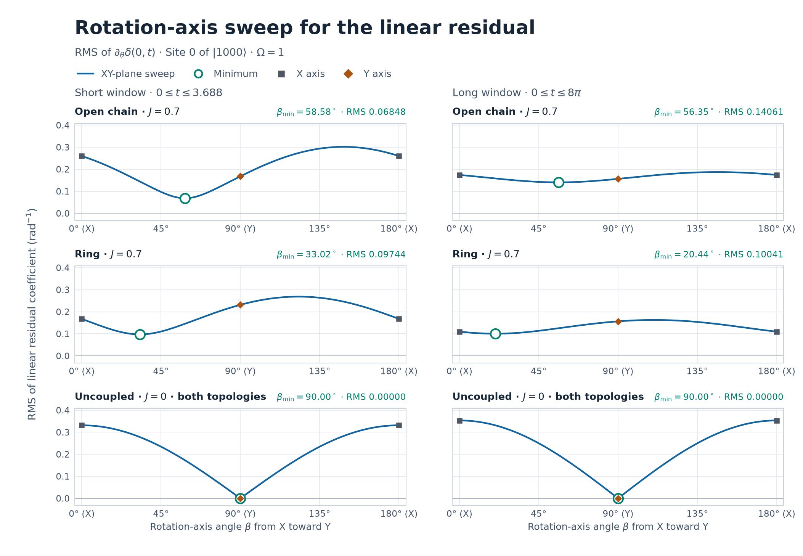

# 逆位相ペアの残差を抑える回転軸

初期状態は \(A=|1000\rangle\)、回転するサイトは0、\(\Omega=1\)。前回と同じ横磁場イジング・ハミルトニアンで、直線と輪を \(J=0,0.7\) で計算した。直線では \(\delta=R_0+R_3-1\)、輪では \(\delta=R_0+R_2-1\) を使う。短窓は \([0,3.688]\)、長窓は \([0,8\pi]\)。 [前回の X・Y 比較とハミルトニアンの定義](../antiphase-xy-rotation-2026-11-10/REPORT.md)

## 窓ごとの最適軸と改善幅

\(\beta\) は XY 平面内で X から Y に向けて測った軸角。相対位相は \(\phi=-90^\circ-\beta\pmod{360^\circ}\) で、表では \(\beta,\phi\) をそれぞれ \(180^\circ\) 周期で表示した。RMS はいずれも残差の角度一次係数の時間 RMS。低下率の基準は、同じ接続・窓で X と Y のうち RMS が小さい方。

| \(J=0.7\) | 最適軸 \(\beta_*\) | 最適位相 \(\phi_*\) | X の RMS | Y の RMS | 最小 RMS | 絶対低下幅 | 低下率 |
|:---|---:|---:|---:|---:|---:|---:|---:|
| 直線・短窓 | \(58.584^\circ\) | \(31.416^\circ\) | 0.259974 | 0.167793 | **0.068484** | 0.099309 | **59.19%** |
| 直線・長窓 | \(56.346^\circ\) | \(33.654^\circ\) | 0.174295 | 0.156438 | **0.140610** | 0.015828 | **10.12%** |
| 輪・短窓 | \(33.015^\circ\) | \(56.985^\circ\) | 0.167691 | 0.231534 | **0.097438** | 0.070253 | **41.89%** |
| 輪・長窓 | \(20.444^\circ\) | \(69.556^\circ\) | 0.109937 | 0.156545 | **0.100408** | 0.009529 | **8.67%** |

直線では Y、輪では X が改善率の基準になった。長窓にすると両接続で改善率が下がり、最適軸は X 寄りに動いた。移動幅は直線で \(2.24^\circ\)、輪で \(12.57^\circ\)。\(J=0\) では両接続・両窓で Y が厳密な最適軸で、最小 RMS はゼロ。X の RMS は短窓で \(0.331591\)、長窓で \(0.353553\)。この対照では基準軸の RMS もゼロなので、低下率は CSV で空欄とした。

## 連続掃引の式

\(B=|0000\rangle\)、\(S(t)=e^{itH}(Z_0+Z_k)e^{-itH}\)、\(C(t)=\langle A|S(t)|B\rangle\) とする。回転演算子 \(e^{-i\theta(\cos\beta X_0+\sin\beta Y_0)/2}\) を \(A\) に作用させると、\(B\) の係数は \(-i e^{-i\beta}\sin(\theta/2)\)。したがって一次係数は

\[
L_\beta(t)=f_X(t)\cos\beta+f_Y(t)\sin\beta,\qquad
f_X=-\tfrac12\operatorname{Im}C,\quad f_Y=\tfrac12\operatorname{Re}C.
\]

\(v_\beta=(\cos\beta,\sin\beta)^{\mathsf T}\)、\(f=(f_X,f_Y)^{\mathsf T}\) として、窓の Gram 行列を \(G(T)=T^{-1}\int_0^T f(t)f(t)^{\mathsf T}\,dt\) と置く。最小固有値を \(\lambda_{\min}\)、最大固有値を \(\lambda_{\max}\) とすると、最小 RMS は \(\sqrt{\lambda_{\min}}\)、軸角 \(\beta_*\) は最小固有ベクトルの向き。連続掃引の全曲線は

\[
\mathrm{RMS}(\beta)^2=v_\beta^{\mathsf T}G(T)v_\beta
=\lambda_{\min}+(\lambda_{\max}-\lambda_{\min})\sin^2(\beta-\beta_*)
\]

で表せる。図と CSV はこの曲線を \(0.25^\circ\) 間隔で評価し、図の最適点には固有ベクトルから求めた角度を使った。 [レイリー商の変分原理](https://math.mit.edu/~stevenj/18.303/minmax.pdf)

\(J=0.7\) の4条件では、\(G_{XY}=\langle f_X f_Y\rangle_t<0\)。同じ符号の X・Y 成分を混ぜると、RMS 二乗の交差項 \(2G_{XY}\sin\beta\cos\beta\) が負になる。\(G_{XY}\) は直線で短窓 \(-0.038416\)、長窓 \(-0.007062\)、輪で短窓 \(-0.028665\)、長窓 \(-0.005377\)。長窓では両接続でこの相殺が弱くなった。

## 厳密にゼロになる条件と有限角への適用

\(J=0\) では \(f_Y=0\)、\(f_X=-\sin(\Omega t)/2\)。従って \(\mathrm{RMS}(\beta)=\mathrm{RMS}(X)|\cos\beta|\) となり、Y で厳密にゼロ。一方、\(\Omega J\ne0\) では \(f_X=-\Omega t/2+O(t^3)\)、\(f_Y=d_0\Omega Jt^2/4+O(t^4)\) で、\(d_0=1\)（直線）、\(2\)（輪）。この二つはどちらの観測窓でも線形独立なので、どの固定軸にも正の RMS が残る。

符号付き残差の奇成分は任意の角度で \(\delta_{\rm odd}=\sin\theta\,L_\beta(t)\) となる。従って前回の非ゼロ角でも、奇成分の RMS の最適軸と低下率は表と同じ。正負の総残差をまとめて \(\sqrt{\langle(\delta(+\theta,t)^2+\delta(-\theta,t)^2)/2\rangle_t}\) を取る場合も、二乗で偶成分と奇成分の交差項が消える。偶成分は軸によらないため最適軸は一致する。この総残差には偶成分の RMS も含まれるので、表の低下率は角度一次係数と奇成分に対応する。

## 数値検証と再現

固有エネルギー差で展開した \(f_X,f_Y\) の積を連続時間で積分した。積に現れる周波数を \(\nu\) とすると、窓平均は \(e^{i\nu T/2}\operatorname{sinc}(\nu T/2)\)。ここで \(\operatorname{sinc}x=\sin x/x\) とし、\(\nu=0\) では1を使った。

別途、状態ベクトルから計算した波形を約0.002刻みで台形積分したところ、Gram 行列の要素は最大 \(2.1\times10^{-8}\) 以内で一致した。刻みを半減すると差は \(5.1\times10^{-9}\) 以下。有限角 \(\theta=\pm0.025,\pm0.05,\pm0.10,\pm0.20\) について、X・Y・最適軸で状態を直接発展させた奇成分は \(1.7\times10^{-16}\) 以内、正負をまとめた平均二乗は \(3.0\times10^{-18}\) 以内で上の式と一致した。

NumPy と Matplotlib を使い、プロジェクトのルートから実行する。

~~~sh
python -B experiments/antiphase-axis-optimization-2026-11-10/run.py
python -B experiments/antiphase-axis-optimization-2026-11-10/plot.py
~~~

[全条件の最適軸と改善幅](optima.csv) · [連続掃引の数値](sweep.csv) · [検証誤差](audit.json)
