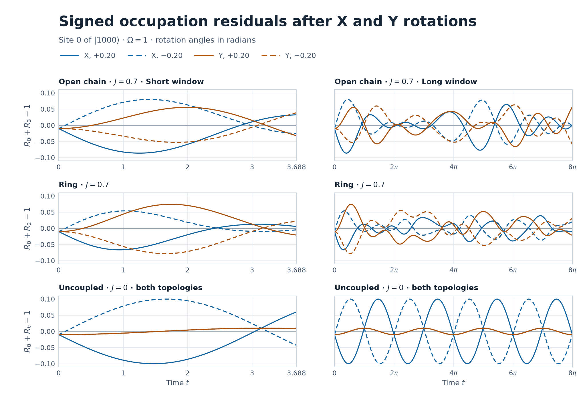

# 0番量子ビットの X 軸回転と Y 軸回転

初期状態は \(\lvert1000\rangle\)。左からサイト \(0,1,2,3\) とし、前回と同じハミルトニアンと占有率を使った。 [前回の符号付き Y 回転](../antiphase-y-signed-2026-11-10/REPORT.md)

\[
H=\frac{\Omega}{2}\sum_{j=0}^3 X_j+\frac J2\sum_{(j,l)\in E}Z_jZ_l,\qquad
R_j(t)=\frac{1-\langle Z_j(t)\rangle}{2}.
\]

直線の辺は \(01,12,23\)、輪には \(30\) を加える。\(\Omega=1\)、\(J=0,0.7\)、\(\theta=0,\pm0.025,\pm0.05,\pm0.10,\pm0.20\) rad。短窓 \([0,3.688]\) は1,845点、長窓 \([0,8\pi]\) は12,567点で、どちらも両端を含む約0.002刻み。各時刻の発展は固有値分解から直接評価した。

## 初期状態と一般の相対位相

\(A=\lvert1000\rangle\)、\(B=\lvert0000\rangle\)、\(c=\cos(\theta/2)\)、\(s=\sin(\theta/2)\) と置く。標準パウリ行列で \(X\lvert1\rangle=\lvert0\rangle\)、\(Y\lvert1\rangle=-i\lvert0\rangle\) なので、

\[
e^{-i\theta X_0/2}A=cA-i sB,\qquad
e^{-i\theta Y_0/2}A=cA-sB.
\]

\(\psi_{\theta,\phi}=cA+e^{i\phi}sB\) と書くと、X は \(\phi=-\pi/2\)、Y は \(\phi=\pi\)。\(\phi\) は符号付きの \(s\) に掛かる位相と定義した。\(\theta<0\) で \(B\) の振幅を正に取り直すと、相対位相はさらに \(\pi\) ずれる。

直線では \(k=3\)、輪では \(k=2\) とする。\(S(t)=e^{itH}(Z_0+Z_k)e^{-itH}\)、\(S_A=\langle A|S(t)|A\rangle\)、\(S_B=\langle B|S(t)|B\rangle\)、\(C=\langle A|S(t)|B\rangle\) とすると、符号付き残差は

\[
\delta=R_0+R_k-1=-\frac12\left[c^2 S_A+s^2 S_B+
\sin\theta\,\operatorname{Re}(e^{i\phi}C)\right].
\]

両接続で \(S_A=0\) が厳密に成り立つ。下の導出を使うと、正負の残差の半和と半差は

\[
\delta_{\mathrm{even}}=-\frac{\sin^2(\theta/2)}2 S_B,\qquad
\delta_{\mathrm{odd}}=-\frac{\sin\theta}2
    \left(\cos\phi\,\operatorname{Re}C-\sin\phi\,\operatorname{Im}C\right).
\]

したがって角度一次の係数は

\[
L_\phi(t)=\left.\partial_\theta\delta\right|_{\theta=0}
=-\frac12\left(\cos\phi\,\operatorname{Re}C(t)-\sin\phi\,\operatorname{Im}C(t)\right).
\]

**X は \(-\operatorname{Im}C/2\)、Y は \(+\operatorname{Re}C/2\)** が一次係数で、奇成分全体は \(\sin\theta\, L_\phi(t)\)。特定の時刻で \(C\ne0\) なら、\(\phi+\arg C=\pi/2\bmod\pi\) でその時刻の奇成分は全次数で消える。\(C=0\) なら全位相で消える。一次項だけが消えて角度三次から始まる場合は、この初期状態族には存在しない。偶成分は回転軸に依存せず、\(|S_B|\le2\)、\(S_B(0)=2\) なので、両窓の最大絶対値は厳密に \(\sin^2(\theta/2)\)。

## 対称性と先頭次数

**直線。** \(a_{2j}=(\prod_{l<j}X_l)Z_j\)、\(a_{2j+1}=(\prod_{l<j}X_l)Y_j\) とする。マヨラナ演算子は \(a(t)=F(t)a(0)\)、\(F(t)=e^{Mt}\) と線形に発展する。\(M\) の上隣接成分は \((\Omega,J,\Omega,J,\Omega,J,\Omega)\)、下隣接成分はその負の転置。左端の \(Z_0(t)\) で \(A,B\) を結ぶ項は \(F_{01}Y_0\) と \(F_{02}X_0 Z_1\)。右端から同じ展開をすると、先頭の \(Z_3\) 以外の文字列は少なくとも一つのサイト \(1,2,3\) を反転する。これらのサイトは \(A,B\) ともに \(\lvert0\rangle\) なので、右端の対角要素はともに \(F_{00}\)、交差要素はゼロ。左端の対角要素は \(A,B\) の順に \(-F_{00},+F_{00}\)。よって

\[
S_A=0,\qquad S_B=2F_{00},\qquad C=F_{02}+iF_{01},\qquad
R_3=(1-F_{00})/2
\]

が任意の \(t,\theta,\phi\) に対して成り立つ。 [前回の端点導出](../antiphase-constraints-2026-11-10/REPORT.md) · [Pfeuty の横磁場イジング鎖のフェルミオン変換](https://www.math.ucdavis.edu/~bxn/pfeuty1970.pdf)

**輪。** 半周回転 \(P_2=(02)(13)\) と計算基底での複素共役 \(K\) を使い、\(\Theta=P_2(\prod_j Z_j)X_0X_2 K\) とする。\(X_0X_2\) は全辺の \(ZZ\) の符号を、\(\prod_j Z_j\) は全 \(X_j\) の符号を反転させる。\(P_2\) は辺を置換する。よって \(\Theta H\Theta^{-1}=-H\)。\(\Theta\) は反ユニタリなので \(e^{-itH}\) を保ち、さらに \(\Theta A=-A\)、\(\Theta(Z_0+Z_2)\Theta^{-1}=-(Z_0+Z_2)\)。この実期待値は符号を反転しても等しく、\(S_A=0\) が従う。

**両接続。** \(H,S(0),A,B\) は計算基底で実数なので \(C(-t)=C(t)^*\)。従って X の角度奇成分は時間について奇、Y は偶。さらに初期時刻で

\[
\dot Z_i=\Omega Y_i,\qquad
\ddot Z_i=-\Omega^2 Z_i+\Omega J X_i\sum_{j\sim i}Z_j.
\]

\(\langle A|Y_0|B\rangle=i\)、\(\langle A|X_0\sum_{j\sim0} Z_j|B\rangle=d_0\) で、\(k\) 側の交差要素はこの二つの微分でゼロ。\(d_0=1\)（直線）、\(2\)（輪）として

\[
\operatorname{Im}C=\Omega t+O(t^3),\qquad
\operatorname{Re}C=\frac{d_0\Omega J}{2}t^2+O(t^4).
\]

X の奇成分の先頭は \(-(\Omega/2)\sin\theta\,t\)。X で時間二次を含む全偶次数が厳密に消えるが、角度一次は \(J=0,0.7\) のどちらでも残る。Y の奇成分は \(J=0.7\) で \((d_0\Omega J/4)\sin\theta\,t^2\) から始まる。\(\Omega J\ne0\) では、どちらの窓でも角度一次の波形を恒等的に消す固定 \(\phi\) は存在しない。時間一次を消すには \(\sin\phi=0\) が必要で、そのとき時間二次の係数に \(\cos\phi=\pm1\) が残る。

結合の符号に関しても、\(Q=\prod_j Z_j\) は \(QH(J)Q=-H(-J)\)、\(QA=-A\)、\(QB=B\) を満たす。従って \(C_J(t)=-C_{-J}(t)^*\) で、実部は \(J\) の奇関数、虚部は \(J\) の偶関数。固定時刻では Y の奇成分は少なくとも \(J\) 一次、X の奇成分への結合による補正は少なくとも \(J\) 二次から現れる。

## 符号付き残差の数値比較

下表は \(J=0.7\) のサンプル最大値。奇成分は \(|\theta|=0.20\)。符号付きピークは絶対値が最大となった時刻の \(\delta\) で、各欄の順は \(+0.20/-0.20\)。正負それぞれの最小・最大と時刻、平均、RMS は全角度について [residuals.csv](residuals.csv) に収録した。

| 接続・窓 | \(\max\lvert\operatorname{Im}C\rvert\) / \(\max\lvert\operatorname{Re}C\rvert\) | 奇成分最大絶対値 X / Y | 符号付きピーク X | 符号付きピーク Y |
|:---|---:|---:|---:|---:|
| 直線・短 | 0.832137 / 0.542124 | 0.082660 / 0.053852 | −0.085897 / +0.080055 | +0.055730 / −0.052515 |
| 直線・長 | 0.832137 / 0.649603 | 0.082660 / 0.064528 | −0.085897 / +0.080055 | −0.065893 / +0.063318 |
| 輪・短 | 0.604655 / 0.767118 | 0.060063 / 0.076201 | −0.066297 / +0.054131 | +0.074495 / −0.078142 |
| 輪・長 | 0.604655 / 0.767118 | 0.060063 / 0.076201 | −0.066297 / +0.054131 | +0.074495 / −0.078142 |

全角度の偶成分最大は \(|\theta|=0.025,0.05,0.10,0.20\) の順に \(0.000156242,0.000624870,0.002497917,0.009966711\)。半差を \(\sin|\theta|\) で割ると角度によらず同じ波形になった。符号付き波形から直接分離した値と \(S_B,C\) の公式との差は、偶成分で \(9.0\times10^{-15}\)、奇成分で \(7.2\times10^{-16}\) 以下。ゼロ角の残差と \(J=0\) の Y の奇成分は厳密なゼロで、計算値の丸め残差はそれぞれ \(9.1\times10^{-15}\)、\(6.7\times10^{-16}\) 以下だった。一方、例えば直線の \(J=0.7,\theta=+0.20\) の X の窓平均は短窓で \(-0.037091\)、長窓で \(-0.003578\)。長窓で平均が小さくなっても、奇成分の最大は両窓で約 \(0.082660\) 残る。

## 元の逆位相ペアの位相と振幅

前回と同様に \(|E_a-E_b|\le10^{-10}\) を DC とし、正の固有エネルギー差 \(E_a-E_b>10^{-10}\) の複素係数を2倍して解析信号 \(u_i\) を作った。\(R_i=R_i^{\mathrm{dc}}+\operatorname{Re}u_i\)。位相差は \(\arg u_0-\arg u_k\) で、全4サイトの \(|u_i|\ge0.05\) を満たす時刻を採用した。位相差の単位複素数の台形加重平均の偏角を円平均、絶対値を PLV とし、瞬間位相差を \([-180^\circ,180^\circ]\) に折り返した後の絶対値の平均も記録した。残差の計算には DC を含む全成分を使った。 [前回の実装と定義](../antiphase-y-signed-2026-11-10/REPORT.md) · [解析信号による位相の定義、Rosenblum ほか](https://journals.aps.org/prl/abstract/10.1103/PhysRevLett.76.1804)

下表は \(J=0.7\) で、同じ符号付き角度の X と Y の両方が振幅条件を満たす共通時刻での比較。各欄は X / Y。\(180^\circ\) と \(-180^\circ\) は同じ向きを表す。

| 接続・窓 | \(\theta\) | 共通採用率 | 円平均位相差（度） | 平均絶対位相差（度） | PLV |
|:---|---:|---:|---:|---:|---:|
| 直線・短 | +0.20 | 97.10% | −169.05 / +171.98 | 169.05 / 171.98 | 0.999997 / 0.996181 |
| 直線・短 | −0.20 | 99.86% | +170.20 / −170.77 | 170.20 / 170.76 | 0.999910 / 0.993803 |
| 直線・長 | +0.20 | 60.35% | −169.75 / +177.11 | 169.58 / 170.33 | 0.997269 / 0.974525 |
| 直線・長 | −0.20 | 63.17% | +168.86 / −174.96 | 168.84 / 170.16 | 0.996337 / 0.979750 |
| 輪・短 | +0.20 | 100% | −176.25 / +171.21 | 175.37 / 171.21 | 0.997540 / 0.998100 |
| 輪・短 | −0.20 | 100% | +176.69 / −168.22 | 175.73 / 168.22 | 0.997768 / 0.994878 |
| 輪・長 | +0.20 | 92.93% | −176.78 / +175.40 | 174.37 / 172.57 | 0.994067 / 0.991046 |
| 輪・長 | −0.20 | 91.79% | +177.82 / −174.07 | 175.43 / 170.72 | 0.995647 / 0.985657 |

\(\theta=0\) では \(u_0=-u_k\) が厳密に成り立ち、採用時刻で位相差は \(180^\circ\)、PLV は1。非ゼロの8角度では、直線の両窓と輪の長窓で X の PLV が高かった。輪の短窓では \(+0.10,+0.20\) のみ Y の方が高い。一方、平均絶対位相差は輪の両窓で全8角度とも X の方が \(180^\circ\) に近く、直線の短窓では全8角度とも Y の方が近かった。PLV は位相差の集中度を測るため、逆位相からのずれが一定でも1に近づく。直線の長窓での比較は、共通採用率が上表のように下がる。

振幅は前回と同じく全窓の占有率の半レンジ \((\max R_i-\min R_i)/2\) で比較した。下表は \(J=0.7\) の各サイトの半レンジを \((0,k)\) の順に示す。位相の採用時刻での平均包絡振幅も [phases.csv](phases.csv) に収録した。

| 接続・窓 | \(\theta\) | X の半レンジ \((0,k)\) | Y の半レンジ \((0,k)\) |
|:---|---:|---:|---:|
| 直線・短 | +0.20 | (0.36871, 0.37277) | (0.36087, 0.37277) |
| 直線・短 | −0.20 | (0.37306, 0.37277) | (0.37719, 0.37277) |
| 直線・長 | +0.20 | (0.44558, 0.45052) | (0.44155, 0.45052) |
| 直線・長 | −0.20 | (0.45043, 0.45052) | (0.44171, 0.45052) |
| 輪・短 | +0.20 | (0.29806, 0.30914) | (0.30273, 0.30619) |
| 輪・短 | −0.20 | (0.30855, 0.30400) | (0.30804, 0.30646) |
| 輪・長 | +0.20 | (0.41065, 0.42502) | (0.40846, 0.42091) |
| 輪・長 | −0.20 | (0.40559, 0.39019) | (0.40285, 0.39686) |

直線で相手サイトの振幅が揃うのは、上で示した \(R_3\) の恒等式による。\(F'=FM\) より \(F'_{00}=-\Omega F_{01}\) なので、直線の \(R_0^X=(1+\cos\theta F_{00}+(\sin\theta/\Omega)F'_{00})/2\)。正周波数 \(\omega\) ごとに無回転のサイト0信号へ \(\cos\theta+i(\omega/\Omega)\sin\theta\) が掛かる。この式は角度一次での時間シフト \(\theta/\Omega\) と、結合がある場合に位相のずれが周波数によって変わることを示す。

両接続で、今回の \(J\) におけるスペクトル DC は全サイトで厳密に \(1/2\)。全反転 \(P=\prod_j X_j\) は \(H\) と可換で \(Z_i\) と反可換なので、DC の \(Z_i\) 成分が存在するには異なる \(P\) 部門で同一固有値が必要になる。\(J=0\) の二部門の固有値集合は \(\{-2,0,2\}\) と \(\{-1,1\}\)。\(J=0.7\) では \(20H=10\sum_j X_j+7\sum_{(j,l)}Z_jZ_l\)。計算基底の補ビット列ペアの和・差を基底とする各部門は整数行列で、法7で \(ZZ\) が落ちる。法7でも \(X\) の固有基底は可逆なので、両部門の固有値はそれぞれ \(\{-40,0,40\}\) と \(\{-20,20\}\) の剰余となり、共通根を持たない。モニックな整数特性多項式が法7で互いに素なため、元の二部門にも共通固有値はない。

## \(J=0\) の対照

両接続で \(C=i\sin(\Omega t)\)、\(S_B=2\cos(\Omega t)\)。一般の一次係数は \(L_\phi(t)=\tfrac12\sin\phi\sin(\Omega t)\) なので、\(\phi=0,\pi\bmod 2\pi\) で奇成分が恒等的にゼロとなる。X・Y の残差は

\[
\delta_X=-\sin(\theta/2)\sin(\Omega t+\theta/2),\qquad
\delta_Y=-\sin^2(\theta/2)\cos(\Omega t).
\]

\(|\theta|=0.20\) の連続時間の最大絶対残差は、両窓で X が \(0.0998334\)、Y が \(0.0099667\)。長窓はちょうど4周期なので両残差の連続時間平均は厳密にゼロになる。X の奇成分は窓内で残る。

解析信号は \(u_0^X=e^{i(\Omega t+\theta)}/2\)、\(u_0^Y=\cos\theta\,e^{i\Omega t}/2\)、\(u_k=-e^{i\Omega t}/2\)。全時刻が振幅条件を満たし、両軸とも PLV は厳密に1。円平均位相差は X が \(\pi+\theta\bmod2\pi\)、Y が \(\pi\)。包絡振幅はサイト0で X が \(1/2\)、Y が \(\tfrac12\cos\theta\)、相手サイトは \(1/2\)。半レンジも同じ値を取るが、短窓の X の正角だけはサイト0の山が窓外にあるため \((1+\cos\theta)/4\) になる。X と Y の差は非結合でも生じ、Y の角度奇成分と多周波の位相変動は結合ありで現れた。

## 検証範囲と再現

- **証明。** 一般位相の角度一次係数、偶成分の軸からの独立性、無回転時の補完関係、X・Y の時間偶奇と結合の符号に関する偶奇、非結合時の残差・位相・振幅を導出した。
- **数値で確認。** 全角度・全条件の符号付き残差、偶奇成分、位相差・PLV・振幅を比較した。占有率のスペクトル再構成と状態ベクトルからの直接計算は \(1.5\times10^{-15}\) 以内、直線のマヨラナ交差項は \(9.2\times10^{-15}\) 以内。一般位相の式は別途 \(\phi=\pi/4,\theta=\pm0.20\) で \(1.6\times10^{-15}\) 以内で一致した。前回の Y 回転の保存値とは、残差の最大絶対値・窓平均が \(4.5\times10^{-16}\) 以内、各条件固有の採用時刻での位相集計が保存精度で一致した。刻みを半減したとき、最大絶対残差の変化は \(5.0\times10^{-8}\)、半レンジは \(2.0\times10^{-7}\)、円平均位相差は \(0.0037^\circ\)、PLV は \(1.6\times10^{-5}\) 以下。
- **未確認。** \(J=0.7\) での窓内極値の解析値と、結合・窓・包絡閾値を変えた場合にも上記の PLV や位相差の順位が続くかは未確認。表の極値はサンプル上の値。

NumPy 2.3.5 でプロジェクトのルートから次を実行する。図の再生成には Matplotlib を使う。

~~~sh
python -B experiments/antiphase-xy-rotation-2026-11-10/run.py
python -B experiments/antiphase-xy-rotation-2026-11-10/plot.py
~~~

[符号付き残差と半レンジ](residuals.csv) · [偶奇成分と式の照合](parity.csv) · [位相と包絡](phases.csv) · [符号付き波形と交差行列要素](waveforms.csv) · [検証誤差とサンプリング情報](audit.json)

位相 CSV の \(\texttt{native}\) は各条件の採用時刻、\(\texttt{axis_common}\) は同角度での軸間の共通部分、\(\texttt{sign_common}\) は同軸での正負角の共通部分。波形 CSV は各窓の両端と約0.01刻みの時刻を保存し、集計は約0.002刻みの全点で行った。
