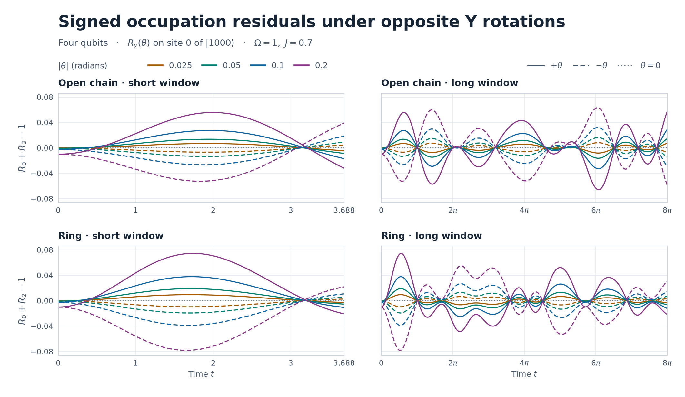

# 正負の \(Y\) 軸回転で分ける逆位相ペアの残差

前回と同じ横磁場イジング・ハミルトニアンで、初期状態の0番だけに \(R_y(\theta)=e^{-i\theta Y_0/2}\) をかけた。\(\Omega=1\)、両接続で \(J=0.7\)、対照は \(J=0\)。角度は \(0,\pm0.025,\pm0.05,\pm0.10,\pm0.20\) rad。観測窓は短窓 \(0\le t\le3.688\)、長窓 \(0\le t\le8\pi\)、延長窓 \(0\le t\le256\) とし、前回と同じ約0.002の間隔で両端を含めて評価した。 [前回の回転検証](../antiphase-y-rotation-2026-11-10/REPORT.md)

## 偶成分と奇成分の式

\(\delta(\theta,t)=R_0(\theta,t)+R_k(\theta,t)-1\) とする。直線では \(k=3\)、輪では \(k=2\)。正の角度の大きさ \(\alpha>0\) に対して、符号付きの波形から

\[
\delta_{\rm even}(\alpha,t)=\frac{\delta(+\alpha,t)+\delta(-\alpha,t)}{2},
\qquad
\delta_{\rm odd}(\alpha,t)=\frac{\delta(+\alpha,t)-\delta(-\alpha,t)}{2}
\]

を求めた。この和と差には回転ゼロの計算値を引く補正を加えていない。

**直線。** \(F(t)=e^{Mt}\) とし、\(M\) は隣接成分 \(M_{m,m+1}=\Omega,J,\Omega,J,\Omega,J,\Omega\) とその負の転置から成るマヨラナ時間発展の生成行列。導出済みの式を角度の偶奇で分けると

\[
\delta_{\rm even}=-\sin^2(\alpha/2)F_{00}(t),\qquad
\delta_{\rm odd}=\frac{\sin\alpha}{2}F_{02}(t).
\]

**輪。** \(A=|1000\rangle\)、\(B=|0000\rangle\)、\(S=Z_0+Z_2\)、\(S(t)=e^{itH}S e^{-itH}\) と置く。回転後の状態は \(\cos(\theta/2)A-\sin(\theta/2)B\) であり、前回の反ユニタリ対称性から \(\langle A|S(t)|A\rangle=0\)。残る対角項と交差項から

\[
\delta_{\rm even}=-\frac{\sin^2(\alpha/2)}{2}\langle B|S(t)|B\rangle,\qquad
\delta_{\rm odd}=\frac{\sin\alpha}{2}\operatorname{Re}\langle A|S(t)|B\rangle.
\]

輪の交差項は \(t=0\) でゼロ。計算基底で \(H,S,A,B\) が実数なので、交差項の実部は \(t\) に関して偶関数になる。さらに \(S\) の二階時間微分に含まれる \(\Omega J X_0(Z_1+Z_3)\) の \(A,B\) 間の行列要素は \(2\Omega J\) であり、他の項の行列要素はゼロ。従って

\[
\operatorname{Re}\langle A|S(t)|B\rangle=\Omega Jt^2+O(t^4),
\qquad
\delta_{\rm odd}=\frac{\Omega J}{2}\sin\alpha\,t^2+O(\sin\alpha\,t^4).
\]

\(\Omega J\ne0\) の輪では、奇成分の角度展開は一次から始まる。係数は時刻によって変わり、例えば \(t=0\) ではゼロになる。両接続とも \(t=0\) で \(\delta(+\alpha,0)=\delta(-\alpha,0)=-\sin^2(\alpha/2)\) であり、\(|\delta_{\rm even}|\) の全窓最大はこの時刻で達する。\(J=0\) では奇成分が恒等的にゼロで、偶成分は \(-\sin^2(\alpha/2)\cos(\Omega t)\)。

## 位相解析での平均と低振幅の扱い

各サイトの占有率は固有エネルギー差で展開し、\(|E_a-E_b|\le10^{-10}\) の全成分を \(R_i^{\rm dc}\) とした。縮退した固有状態間の成分もこの和に含める。窓ごとの標本平均 \(\langle R_i\rangle_{[0,T]}\) は低周波振動を含み得るため、位相の中心化には使わない。正のエネルギー差 \(E_a-E_b>10^{-10}\) の振幅を2倍して複素解析信号 \(u_i\) を作り、\(R_i=R_i^{\rm dc}+\operatorname{Re}u_i\)、\(\phi_i=\arg u_i\) とした。符号付き残差の波形には占有率の全成分を残した。 [解析信号による位相の定義、Rosenblum ほか (1996)](https://journals.aps.org/prl/abstract/10.1103/PhysRevLett.76.1804)

位相の集計では、全4サイトで包絡振幅 \(|u_i|\ge0.05\) を満たす時刻を採用した。正負を同じ時刻で比較する集計には、両符号でこの条件を満たす共通部分を使った。位相差は単位複素数 \(e^{i(\phi_i-\phi_j)}\) を有効時刻で台形加重平均し、その偏角を円平均位相差、絶対値をPLVとする。折り返した瞬間位相差の絶対値の平均も区別して記録した。

例えば \(J=0.7,\theta=+0.20\) の輪では、サイト0のスペクトルDCは \(0.500000\)、短窓の占有率平均は \(0.649943\)。和の残差のスペクトルDCはゼロに丸められるが、短窓での符号付き平均は \(\theta=+0.20\) で \(+0.031857\)、\(-0.20\) で \(-0.037021\) だった。

## 符号付き波形と最大残差

図の縦軸は符号付き残差。回転の符号を反転すると奇成分が反転し、偶成分はそのまま残る。各角度の2本の波形の中点は時刻ごとの偶成分、半差は奇成分。下表は \(J=0.7\) での最大絶対残差を、各セルで \(+\alpha/-\alpha\) の順に示す。

| \(\alpha\) (rad) | 直線・短 | 直線・長 | 直線・延長 | 輪・短 | 輪・長 | 輪・延長 |
|---:|---:|---:|---:|---:|---:|---:|
| 0.025 | .006802/.006751 | .008140/.008099 | .010051/.010164 | .009560/.009617 | .009560/.009617 | .010060/.010179 |
| 0.050 | .013654/.013450 | .016316/.016153 | .019983/.020434 | .019058/.019286 | .019058/.019286 | .020040/.020523 |
| 0.100 | .027502/.026688 | .032760/.032112 | .039467/.041270 | .037850/.038763 | .037850/.038763 | .039738/.041680 |
| 0.200 | .055730/.052515 | .065893/.063318 | .076749/.083946 | .074495/.078142 | .074495/.078142 | .077940/.085688 |

ゼロ回転での最大残差は全条件で \(9.68\times10^{-14}\) 程度以下。\(J=0\) では両符号とも、最大残差は \(\alpha=0.025,0.05,0.10,0.20\) の順に \(0.000156242,0.000624870,0.002497917,0.009966711\)。奇成分の最大値は \(2.22\times10^{-15}\) だった。結合ありでの両符号の最大絶対残差の差は、偶成分の大きさから \(2\sin^2(\alpha/2)\) 以下に収まる。

## 偶奇の照合と小角の次数

直線では16次元のスピン状態から得た偶・奇成分を、8次元の \(e^{Mt}\) から独立に計算した式と全サンプルで照合した。最大絶対誤差は偶 \(5.45\times10^{-14}\)、奇 \(1.16\times10^{-14}\)。輪では \(|1000\rangle,|0000\rangle\) を別々に発展させて対角項と交差項を評価し、偶 \(9.66\times10^{-14}\)、奇 \(4.23\times10^{-15}\) 以内で一致した。

偶成分の最大絶対値は \(\sin^2(\alpha/2)\) で両接続・全窓で共通。奇成分は \(\sin\alpha\) で割ると角度によらず同じ波形になり、下表はその波形の最大絶対値を示す。

| 接続・\(J=0.7\) | 短窓 | 長窓 | 延長窓 |
|:---|---:|---:|---:|
| 直線 | 0.271062 | 0.324802 | 0.404336 |
| 輪 | 0.383559 | 0.383559 | 0.403918 |

輪の短窓で奇成分の最大絶対値は、4角度の順に \(0.009588,0.019170,0.038292,0.076201\)。角度を2倍にしたときの最大値の比の \(\log_2\) は、小さい角度の組 \(0.025\to0.05\) で偶 \(1.999775\)、奇 \(0.999549\) だった。直線・輪ともこの値に一致し、角度が大きくなるにつれて正弦関数の曲率に沿ってわずかに下がった。輪の \(t=0.002\) では \(\delta_{\rm odd}/(\sin\alpha\,t^2)=0.34999954\) となり、短時間の係数 \(\Omega J/2=0.35\) とも一致した。

## 元の逆位相ペア

\(J=0.7,|\theta|=0.20\) で、正負両方の包絡条件を満たす時刻を共通に選んだ結果。各欄は \(+\alpha/-\alpha\) の順。

| 接続 | 窓 | 平均絶対位相差 | PLV | 共通採用率 |
|:---|:---|:---|:---|---:|
| 直線 | 短 | \(171.86^\circ/170.99^\circ\) | 0.9961/0.9942 | 98.3% |
| 直線 | 長 | \(170.92^\circ/171.52^\circ\) | 0.9780/0.9856 | 53.3% |
| 直線 | 延長 | \(172.99^\circ/172.91^\circ\) | 0.9859/0.9865 | 80.4% |
| 輪 | 短 | \(171.21^\circ/168.22^\circ\) | 0.9981/0.9949 | 100.0% |
| 輪 | 長 | \(172.63^\circ/170.70^\circ\) | 0.9915/0.9860 | 91.8% |
| 輪 | 延長 | \(173.66^\circ/171.38^\circ\) | 0.9894/0.9807 | 93.2% |

直線の短窓では同位相度が \(+\alpha\) で \(0.4855\)、\(-\alpha\) で \(0.5105\) だったが、長窓ではそれぞれ \(0.3885,0.3884\)。輪では短窓で \(+\alpha\) の方が大きく、長窓では \(-\alpha\) の方が大きい。符号を反転しても、占有率の和のずれと逆位相の強い固定は共存し、4サイトの同位相度の変化は窓によって異なった。

## 再現

NumPy 2.3.5 の環境で、プロジェクトのルートから `python -B experiments/antiphase-y-signed-2026-11-10/run.py` を実行する。数値の最大値と公式照合には約0.002の全サンプルを使用した。図用の波形は短窓・長窓から約0.01間隔で書き出した。Matplotlib のある環境で同じディレクトリの `plot.py` を実行すると図を再生成できる。

[全条件の集計と照合誤差](results.json) · [符号付き波形と偶・奇成分のCSV](waveforms.csv)
