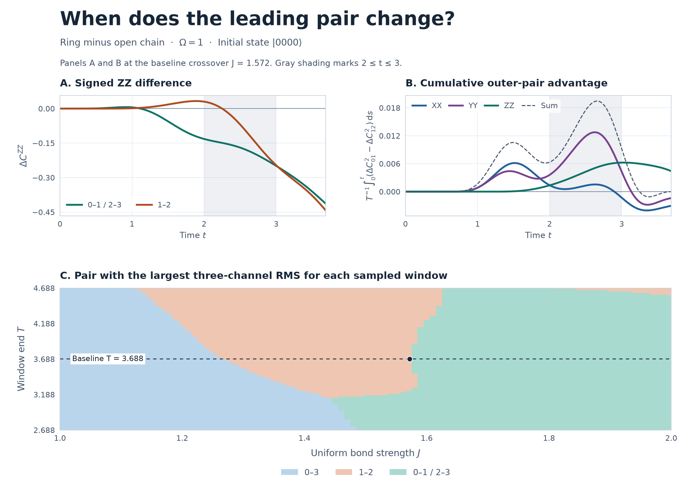

# 外側ペアと中央ペアの首位交代を時間帯で分解する

2026年11月10日。4量子ビットの直線と輪を同じ \(J\) で比較した。横磁場は \(\Omega=1\)、初期状態は \(\lvert0000\rangle\)。直線の結合は \(01,12,23\)、輪には \(03\) を加え、存在する全結合の係数を \(J/2\) とした。基準の観測終了時刻は \(T=3.688\)。外側は \(01,23\) の各ペアを指し、両者は反射対称性で一致する。

各軸の連結相関差を \(\Delta C_{ij}^{AA}=C_{ij,\mathrm{ring}}^{AA}-C_{ij,\mathrm{open}}^{AA}\) とする。外側が中央を上回る時間帯を調べるために、次の差を積分した。

\[
g_A(t,J)=(\Delta C_{01}^{AA})^2-(\Delta C_{12}^{AA})^2,\qquad
G_A(a,b;J)=\frac{1}{T}\int_a^b g_A(t,J)\,dt.
\]

区間ごとの積分はすべて同じ \(T\) で割った。3軸の全区間の和は、前回の合成RMSの二乗差 \(D_{01}^2-D_{12}^2\) に等しい。正なら外側が上位。

## 交点で外側の \(ZZ\) を支えるのは \(t=2\)〜\(3\)

| 時間帯 | \(ZZ\) の寄与、\(J=1.55\) | \(ZZ\) の寄与、\(J=1.572027\) | \(ZZ\) の寄与、\(J=1.60\) | \(J=1.55\to1.60\) での3軸合計の寄与の変化 |
|:---|---:|---:|---:|---:|
| 0〜1 | +0.000003 | +0.000003 | +0.000003 | +0.000309 |
| 1〜2 | +0.001278 | +0.001354 | +0.001444 | +0.001094 |
| 2〜3 | +0.005091 | **+0.004887** | +0.004593 | −0.000761 |
| 3〜3.688 | −0.001668 | −0.001846 | −0.002101 | **+0.003178** |
| 全区間 | +0.004704 | +0.004397 | +0.003939 | +0.003821 |

\(t=2.25\) では、輪の \(C^{ZZ}\) は外側と中央で共通の \(0.180601\)。直線の中央は \(0.180453\) と輪に近い一方、直線の外側は \(0.329534\) だった。このときの「輪 − 直線」は外側で \(-0.148933\)、中央で \(+0.000148\)。\(t\simeq3.028\) を過ぎると \(ZZ\) の二乗差では中央が上回り、中盤に外側が得た差を一部打ち消す。

## 交点をまたぐと \(XX,YY\) の劣勢が縮む

| \(J\) | \(XX\) の全区間寄与 | \(YY\) の全区間寄与 | \(ZZ\) の全区間寄与 | 3軸合計 |
|---:|---:|---:|---:|---:|
| 1.55 | −0.003883 | −0.002577 | +0.004704 | −0.001755 |
| 1.572027 | −0.003025 | −0.001372 | +0.004397 | 約0 |
| 1.60 | −0.001963 | +0.000090 | +0.003939 | +0.002065 |

交点では \(ZZ\) のプラスが \(XX,YY\) のマイナスを補う。\(J=1.55\to1.60\) の範囲では \(ZZ\) の優位は \(0.000766\) 縮む。その一方で \(XX,YY\) の寄与はそれぞれ \(0.001920,\ 0.002666\) 改善する。3軸合計の改善 \(0.003821\) の約83%は \(t=3\)〜\(3.688\) の区間から来ており、この区間では特に \(YY\) の改善が大きい。

\(YY\) 単独の時間RMSでは、外側が中央を追い越すのは **\(J\simeq1.598245\)**。交点で両者のRMSは約 \(0.169532\)。3軸合計の交点より \(J\) が約 \(0.0262\) 大きい。

## 観測窓への依存

| 観測終了時刻 \(T\) | \(J=1\)〜\(2\) での首位の順序 | 首位交代の \(J\) |
|---:|:---|:---|
| 2.688 | \(03\to01,23\) | 1.4851 |
| 3.188 | \(03\to12\to01,23\) | 1.4214、1.5308 |
| 3.588 | \(03\to12\to01,23\) | 1.2901、1.5742 |
| 3.688 | \(03\to12\to01,23\) | 1.2677、1.5720 |
| 3.788 | \(03\to12\to01,23\) | 1.2492、1.5747 |
| 4.188 | \(03\to12\to01,23\) | 1.1970、1.5947 |
| 4.688 | \(03\to12\to01,23\to12\) | 1.1276、1.6352、1.8019 |

\(T=3.688\) を前後 \(0.1\) 動かした場合、中央から外側への首位交代点の変化は約 \(0.0021\)〜\(0.0027\)。窓を大きく動かすと首位の順序自体も変わる。例えば \(T=2.688\) では中央と外側は \(J\simeq1.3777\) で同率になるが、その時点の首位は \(03\)。表は有限時間で積分した相関差の順位を示す。

## 再現と照合

NumPy 2以上の環境で `python -B run.py` を実行する。既存の16次元の固有値分解と連結相関計算を再利用した。走査は \(J=1.00\)〜\(2.00\) を \(0.01\) 刻み、\(T=2.688\)〜\(4.688\) を \(0.02\) 刻み。表の終了時刻ごとの交点は、首位が変わる隣接 \(J\) の間で二分法を適用した。\(YY\) の交点も同様に絞った。

台形積分の時間刻みを \(0.001\) から \(0.0005\) に半減したとき、時間帯ごとの寄与の変化は最大 \(4.0\times10^{-9}\)。\(YY\) の交点は二分法の探索精度 \(5\times10^{-8}\) の範囲で一致した。基準窓の3軸の交点は前回の計算と一致した。

`waveforms.csv` に直線と輪の \(ZZ\) 波形、各軸の二乗差と累積寄与、`windows.csv` に観測窓の格子上の順位とRMS、`results.json` に基準交点の分解・交点の一覧・数値照合を保存した。Matplotlibのある環境で `python -B plot.py` を実行すると図を再生成できる。
