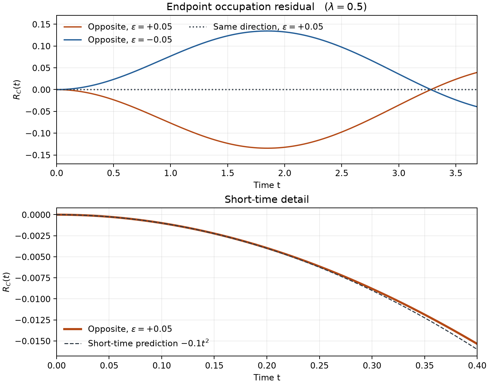
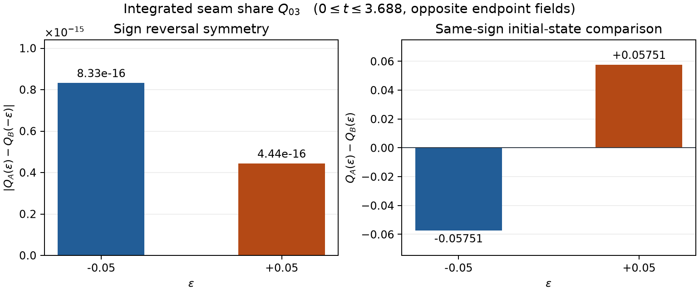

# 4量子ビットの端点磁場と反ユニタリ対称性

2026年11月9日。§17.1 の反ユニタリ対称性を端の横磁場で保つ場合と破る場合を比べた。占有率の短時間展開を検証し、積分した継ぎ目シェアにも差が出るかを調べた。

## 条件と計算方法

既存の条件から \(\Omega=1\)、\(J=0.7\)、\(0\le t\le3.688\) を使用した。主計算は \(\lambda=0.5\)、参照は \(\lambda=0\)。初期状態は \(A=|1000\rangle\) と \(B=|0100\rangle\)。両方の \(\lambda\) に同じ摂動を入れた。同方向は \(\epsilon(X_0+X_3)\)、逆方向は \(\epsilon(X_0-X_3)\) とし、\(\epsilon=\pm0.05\) を選んだ。

16×16の実対称ハミルトニアンを倍精度で対角化し、各時刻の状態を固有値から直接求めた。\(\Delta t=0.002\) と \(0.001\) の等間隔グリッドで標本化し、\(Q_{03}\) は両グリッドで台形積分した。以下の値と図は細かい方のグリッドを使う。

## 占有率の残差

\(R_C(t)=\langle n_0\rangle_A(t)+\langle n_3\rangle_B(t)-1\)、\(n_i=(1-Z_i)/2\) とした。同方向では \(R_C(t)=0\) が厳密に成立する。逆方向では \(R_C(t)=-2\Omega\epsilon t^2+O(t^4)\) と予想した。

\(\lambda=0.5\) で、観測時刻を半分ずつにしたときの収束。

| \(t\) | \(R_C/t^2\), \(\epsilon=+0.05\) | \(R_C/t^2\), \(\epsilon=-0.05\) | 理論係数からの最大絶対差 |
|---:|---:|---:|---:|
| 0.160 | −0.099335949 | +0.099335949 | 6.64e−4 |
| 0.080 | −0.099833597 | +0.099833597 | 1.66e−4 |
| 0.040 | −0.099958375 | +0.099958375 | 4.16e−5 |
| 0.020 | −0.099989592 | +0.099989592 | 1.04e−5 |
| 0.010 | −0.099997398 | +0.099997398 | 2.60e−6 |
| 0.005 | −0.099999350 | +0.099999349 | 6.51e−7 |

理論値はそれぞれ −0.1、+0.1。係数の誤差は半減ごとに約4分の1となり、\(R_C/t^2=-2\Omega\epsilon+O(t^2)\) と整合する。

## 継ぎ目シェアの二つの比較

各ペアの連結相関 \(C_{ij}^{aa}=\langle\sigma_i^a\sigma_j^a\rangle-\langle\sigma_i^a\rangle\langle\sigma_j^a\rangle\) を \(a=x,y,z\) で計算した。§14に従い、\(\lambda=0.5\) と \(0\) の差を二乗した値のうち、ペア \(03\) の時間積分を、全6ペア・3チャネルの時間積分で割った。点ごとの \(w_{03}\) に用いる \(10^{-8}\) の閾値はこの積分に適用していない。

| 逆方向の \(\epsilon\) | \(Q_{03}^{A}(\epsilon)\) | \(Q_{03}^{B}(\epsilon)\) | 同符号の差 \(A-B\) | \(\lvert Q_{03}^A(\epsilon)-Q_{03}^B(-\epsilon)\rvert\) |
|---:|---:|---:|---:|---:|
| −0.05 | 0.0175213371 | 0.0750329967 | −0.0575116597 | 8.33e−16 |
| +0.05 | 0.0750329967 | 0.0175213371 | +0.0575116597 | 4.44e−16 |

符号を反転させた比較は厳密な対応と整合した。同符号での差は今回の条件で観測した値である。同方向摂動でも \(Q_{03}^{A}(\epsilon)=Q_{03}^{B}(\epsilon)\) を確認し、最大絶対差は 2.08e−15 だった。

## 数値監査

| 確認項目 | 最大絶対値 |
|---|---:|
| 同方向の \(\lvert R_C\rvert\)、\(\lambda=0.5\) | 2.78e−15 |
| 同方向の \(\lvert R_C\rvert\)、\(\lambda=0\) | 1.33e−15 |
| 状態ノルムの 1 からのずれ、全条件・両グリッド | 1.55e−15 |
| 共通時刻での状態振幅と \(R_C\) の変化、\(\Delta t=0.002\to0.001\) | 0（倍精度で一致） |
| \(Q_{03}\) の変化、\(\Delta t=0.002\to0.001\)、全条件 | 3.90e−8 |

状態を時刻ごとに直接評価しているため、刻み半減の比較は標本化と台形積分の監査になる。独立した JavaScript の4次 Runge–Kutta 計算でも、逆方向摂動の \(Q_{03}\) は約 \(5\times10^{-14}\) 以内で一致した。

再現には NumPy（2.0以上）と Matplotlib を入れた Python で、このフォルダの `python run.py` を実行する。今回の実行は Python 3.14.5、NumPy 2.5.0、Matplotlib 3.11.1 を使用した。各条件の監査値は `results.json` に収録した。
