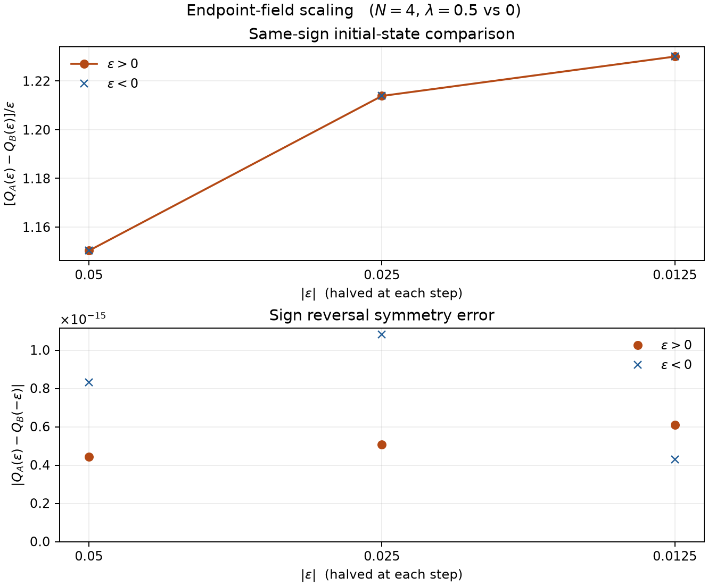

# 逆方向の端点磁場と継ぎ目シェアのスケーリング

2026年11月9日。前回の逆方向摂動 \(\epsilon(X_0-X_3)\) を半分ずつにし、同符号の初期状態差がどの程度半減するかを調べた。

前回と同じ4量子ビット、\(\Omega=1\)、\(J=0.7\)、\(\lambda=0.5\)（参照 \(\lambda=0\)）、積分区間 \(0\le t\le3.688\) を使った。比較する初期状態は \(A=|1000\rangle\)、\(B=|0100\rangle\)。弱リンク側と参照側には同じ摂動を入れ、\(\epsilon=\pm0.05,\pm0.025,\pm0.0125\) の6条件を計算した。\(Q_A,Q_B\) は各初期状態の \(Q_{03}\) で、6ペア・3チャネルの連結相関差の二乗を台形積分して求めた。表と図の積分間隔は \(\Delta t=0.001\)。

## 同符号での初期状態差

\(\Delta Q(\epsilon)=Q_A(\epsilon)-Q_B(\epsilon)\) とした。

| \(\lvert\epsilon\rvert\) | \(\Delta Q(+\lvert\epsilon\rvert)\) | \(\Delta Q(-\lvert\epsilon\rvert)\) | \(\Delta Q/\epsilon\)、両符号 | 前段に対する差の絶対値の比 |
|---:|---:|---:|---:|---:|
| 0.0500 | +0.05751165968 | −0.05751165968 | 1.150233194 | — |
| 0.0250 | +0.03034506705 | −0.03034506705 | 1.213802682 | 52.76% |
| 0.0125 | +0.01537486595 | −0.01537486595 | 1.229989276 | 50.67% |

\(\Delta Q/\epsilon\) の増分は \(0.06357\) から \(0.01619\) へ縮まり、約4分の1になった。符号反転の対応により \(\Delta Q\) は奇関数なので、原点近傍での \(\Delta Q/\epsilon=a+b\epsilon^2+O(\epsilon^4)\) という展開と整合する。最小の2点を \(\epsilon^2\) で外挿すると、傾きの推定は \(a\approx1.2354\) となる。

## 符号反転の対応と数値監査

別々の符号で比較した \(\lvert Q_A(\epsilon)-Q_B(-\epsilon)\rvert\) の最大値は \(1.08\times10^{-15}\) で、厳密な対応と整合した。符号反転の誤差は図の下段に表示した。

積分間隔を \(0.002\) から \(0.001\) に半減したときの変化は、\(\Delta Q\) で最大 \(2.19\times10^{-8}\)、\(\Delta Q/\epsilon\) で最大 \(4.47\times10^{-7}\)。\(\lvert\epsilon\rvert=0.05\) の4つの \(Q_{03}\) 値は、前回の保存値と倍精度で一致した。独立した JavaScript の時間発展計算でも、表の同符号差を確認した。

再現するには、NumPy（2.0以上）と Matplotlib がある環境で、このフォルダの `python run.py` を実行する。前回のフォルダを隣に置くと、既存のハミルトニアンと観測量の関数を読み込んで再利用する。各符号の \(Q_A,Q_B\) と両方の積分間隔の値は `results.json` にある。
