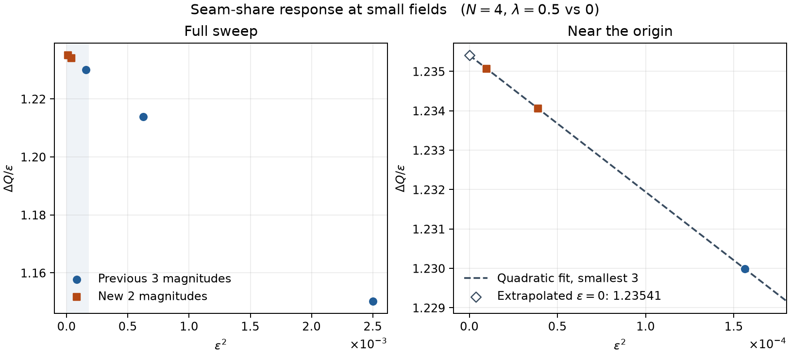

# 継ぎ目シェアの線形応答

2026年11月9日。4量子ビット、\(\Omega=1\)、\(J=0.7\)、\(\lambda=0.5\)（参照 \(\lambda=0\)）、積分区間 \(0\le t\le3.688\) を使用した。両枝に逆方向の端点摂動 \(\epsilon(X_0-X_3)\) を加え、\(\lvert\epsilon\rvert=0.00625,0.003125\) を追加した。\(Q_A,Q_B\) は初期状態 \(A=|1000\rangle\)、\(B=|0100\rangle\) から得た \(Q_{03}\) を指す。前回の固有値による時間発展と、6ペア・3チャネルの連結相関差に対する台形積分を再利用した。

## 同符号差の原点への外挿

\(\Delta Q(\epsilon)=Q_A(\epsilon)-Q_B(\epsilon)\)。表と図は前回と同じ積分間隔 \(\Delta t=0.001\)。前の3点を再計算したところ、保存値と倍精度で一致した。負の \(\epsilon\) では \(\Delta Q\) の符号が反転する。グラフでは正負それぞれの \(\Delta Q/\epsilon\) を平均した。

| \(\lvert\epsilon\rvert\) | \(\epsilon^2\) | \(\Delta Q\)（正の \(\epsilon\)） | \(\Delta Q/\epsilon\)（両符号） |
|---:|---:|---:|---:|
| 0.050000 | 2.5e−3 | 0.057511659680 | 1.150233194 |
| 0.025000 | 6.25e−4 | 0.030345067045 | 1.213802682 |
| 0.012500 | 1.5625e−4 | 0.015374865953 | 1.229989276 |
| 0.006250 | 3.90625e−5 | 0.007712839001 | 1.234054240 |
| 0.003125 | 9.765625e−6 | 0.003859598828 | 1.235071625 |

符号反転の対応から \(\Delta Q(-\epsilon)=-\Delta Q(\epsilon)\)。したがって \(\Delta Q/\epsilon\) を \(x=\epsilon^2\) で描いたとき、\(x=0\) の切片が \(\Delta Q'(0)\) の推定値になる。

| 外挿方法 | 切片（\(\Delta t=0.001\)） | 切片（\(\Delta t=0.0005\)） |
|---|---:|---:|
| 原点に近い2点、直線 | 1.235410753 | 1.235410865 |
| 原点に近い3点、直線 | 1.235409991 | 1.235410103 |
| 原点に近い3点、2次式（図） | 1.235410855 | 1.235410967 |
| 全5点、2次式 | 1.235410888 | 1.235411000 |

この範囲での傾きの推定は \(\Delta Q'(0)\approx1.23541\)。刻みを半減したとき、\(\Delta Q/\epsilon\) と切片の変化はいずれも最大約 \(1.12\times10^{-7}\) だった。外挿と別に行列指数を \(\epsilon=0\) で微分し、連鎖律で積分比まで計算した照合値は \(1.23541085494\)（\(\Delta t=0.001\)）だった。

## 符号反転の対応誤差

\(Q_A(\epsilon)\) と \(Q_B(-\epsilon)\) の差を、外挿に使った同符号の差と分けて記録した。全10条件での最大絶対誤差は \(1.08\times10^{-15}\)（両刻みとも）だった。追加2点で正負の大きい方の誤差は、それぞれ \(7.42\times10^{-16}\)、\(2.71\times10^{-16}\)（\(\Delta t=0.001\)）。

再現するには、前2回の実験フォルダを隣に置き、NumPy（2.0以上）と Matplotlib がある環境で、このフォルダの `python run.py` を実行する。各符号・各刻みの値と外挿係数は `results.json` にある。
