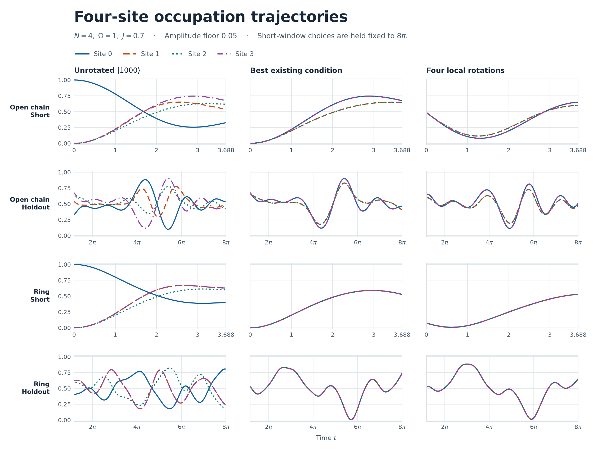
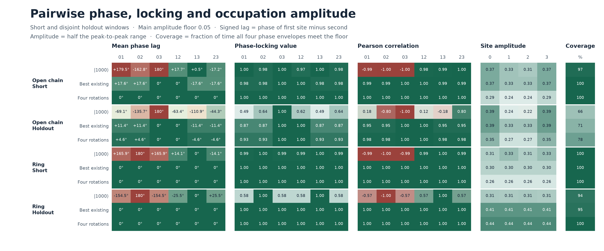

# 4サイトの局所回転による占有率の同位相探索

2026年11月10日。\(N=4,\ \Omega=1,\ J=0.7\) の時間非依存ハミルトニアンで、4サイトの占有率 \(R_i(t)=\langle(I-Z_i)/2\rangle_t\) を比較した。横磁場は \(\Omega X_i/2\)、結合は \(J Z_iZ_j/2\)。直線の結合は \(01,12,23\)、輪は \(03\) を加える。

**輪では、短窓で選んだ4サイト回転が延長窓まで全6ペアで位相差 \(0^\circ\)、PLV 1 を維持した。** 既存の \(\lvert0000\rangle\) も位相は同じで、回転の効果は主に長窓での振幅と有効時刻の増加だった。**直線では短窓の最大平均位相差を \(0.048^\circ\) まで縮めた。** 固定した状態を短窓と重ならない区間で測ると、最小PLVと有効時刻の割合が基準を下回った。



## 判定と選択

探索前に[判定条件](PROTOCOL.md)を固定した。振幅 \(A_i=(\max R_i-\min R_i)/2\) の下限は 0.025、**0.05**、0.10。固有エネルギー差から正周波数成分の2倍を合計した解析信号を \(u_i(t)\) とし、\(\phi_i=\arg u_i\) とした。全サイトで \(|u_i|\ge g\) の時刻だけで \(L_{ij}=\langle e^{i(\phi_i-\phi_j)}\rangle\) を計算した。円平均位相差は \(\arg L_{ij}\)、PLV は \(|L_{ij}|\)。Pearson相関は振幅で時刻を除外せず、窓内の生の占有率から求めた。 [PLVの定義と性質](https://pmc.ncbi.nlm.nih.gov/articles/PMC3674231/)

4サイトすべての \(A_i\ge g\)、有効時刻90%以上、全6ペアの \(|\arg L_{ij}|\le15^\circ\) と PLV \(\ge0.95\) を合格条件とした。合格解の中で、最も揃わないペアを改善するため \(\min_{i<j}\operatorname{Re} L_{ij}\) を最大化した。

選択は短窓 \([0,3.688]\) で完結させた。確定した初期状態を固定し、全窓 \([0,8\pi]\)、時間外検証窓 \([3.688,8\pi]\)、後半 \([4\pi,8\pi]\)、延長窓 \([8\pi,64\pi]\) で測った。時間外検証窓は短窓との境界点を共有する。全窓・後半・延長窓も選択には使用していない。

## 既存の37条件を各接続で再評価

基底状態 \(\lvert0000\rangle,\lvert1000\rangle,\lvert0100\rangle\) と、\(\lvert1000\rangle\) のサイト0を回した34条件を比較した。回転にはX・Y軸、既存の短窓・全窓の斜め軸、XY回転の検算軸を含む。条件名、回転角・軸、4サイトの半振幅と6ペアの位相差・PLV・Pearson相関は [baseline.csv](baseline.csv) にある。

- 無回転の \(\lvert1000\rangle\) では、直線の \(03\)、輪の \(02\) が \(180^\circ\) かつ PLV 1。主下限0.05で、サイト0だけを回した34条件の中で短窓の最大位相差が最も小さい条件でも、直線で \(169.05^\circ\)、輪で \(171.21^\circ\) だった。
- 最良の既存条件は全下限で、直線・輪とも \(\lvert0000\rangle\)。直線は短窓で最大位相差 \(17.65^\circ\)、最小PLV 0.976、最小Pearson 0.994。輪では位相差 \(0^\circ\)、PLV と Pearson相関は1。輪の \(\lvert0000\rangle\) は下限0.05で全窓に合格したが、0.10では時間外検証窓の有効率が87.2%だった。

## 4サイト回転の探索範囲

各サイトの純粋状態を \(\cos(\theta_i/2)\lvert0\rangle+e^{i\phi_i}\sin(\theta_i/2)\lvert1\rangle\) とした。\(\theta_i\in[0,\pi]\)、\(\phi_i\in[-\pi,\pi)\)。これは \(\lvert0\rangle\) から局所的な \(R_z(\phi_i)R_y(\theta_i)\) で準備できる。各接続で、次の候補をBloch球面上一様に生成した。乱数シードは41070。

| 探索した積状態 | 自由角の数 | ランダム候補数 | 軸上の候補数 |
|:--|--:|--:|--:|
| 4サイト独立 | 8 | 32,768 | 256 |
| 鏡映対称 \(\lvert a,b,b,a\rangle\) | 4 | 8,192 | 16 |
| 全サイト同一 \(\lvert a,a,a,a\rangle\) | 2 | 1,024 | 4 |

各下限と各群で短窓の上位8候補を60ステップ局所探索した。各ステップで候補ごとに11個の近傍点を調べた。粗い時間刻みは約0.02。元の上位12候補と局所探索後の8候補を約0.002の刻みで比較し、最終状態を選択した。独立な4サイトの探索からも両接続で短窓合格解を得た。3下限すべてで直線は鏡映対称、輪は全サイト同一の候補が最上位だった。

主下限0.05の選択状態の角度をラジアンで示す。全精度の値と各探索群の最良状態は [selection.json](selection.json) にある。

| 接続 | サイト | \(\theta\) | \(\phi\) |
|:--|:--|--:|--:|
| 直線 | 0, 3 | 1.544881 | 1.568569 |
| 直線 | 1, 2 | 1.534200 | 1.141044 |
| 輪 | 0, 1, 2, 3 | 0.558032 | 0.853965 |

## 4サイトの波形と全6ペア



主下限0.05での直線の選択状態。位相差の符号はサイト \(i\) からサイト \(j\) を引く順。輪の選択状態は以下の全6ペアで、両窓とも \(0^\circ\)、PLV 1、Pearson相関 1。

| ペア | 短窓の位相差 | 短窓 PLV | 短窓 Pearson | 時間外の位相差 | 時間外 PLV | 時間外 Pearson |
|:--|--:|--:|--:|--:|--:|--:|
| 01 | −0.0479° | 0.999992 | 0.996789 | +4.6067° | 0.931149 | 0.979169 |
| 02 | −0.0479° | 0.999992 | 0.996789 | +4.6067° | 0.931149 | 0.979169 |
| 03 | 0° | 1 | 1 | 0° | 1 | 1 |
| 12 | 0° | 1 | 1 | 0° | 1 | 1 |
| 13 | +0.0479° | 0.999992 | 0.996789 | −4.6067° | 0.931149 | 0.979169 |
| 23 | +0.0479° | 0.999992 | 0.996789 | −4.6067° | 0.931149 | 0.979169 |

| 接続・窓 | 最大平均位相差 | 最小PLV | 最小Pearson | 有効時刻 | 選択後の半振幅 \((A_0,A_1,A_2,A_3)\) |
|:--|--:|--:|--:|--:|:--|
| 直線・短窓 | 17.65° → 0.048° | 0.9761 → 0.99999 | 0.9941 → 0.9968 | 100% → 100% | (0.2852, 0.2412, 0.2412, 0.2852) |
| 直線・時間外 | 11.39° → 4.61° | 0.8744 → 0.9311 | 0.9498 → 0.9792 | 70.87% → 77.99% | (0.3504, 0.2677, 0.2677, 0.3504) |
| 輪・短窓 | 0° → 0° | 1 → 1 | 1 → 1 | 100% → 100% | (0.2597, 0.2597, 0.2597, 0.2597) |
| 輪・時間外 | 0° → 0° | 1 → 1 | 1 → 1 | 95.08% → 100% | (0.4352, 0.4352, 0.4352, 0.4352) |

矢印の左側は最良の既存条件 \(\lvert0000\rangle\)。直線では時間外の最大平均位相差が \(6.79^\circ\) 減り、最小PLVは0.0568、有効時刻は7.12ポイント増えた。最小半振幅は0.3259から0.2677に下がった。輪では時間外の最小半振幅が0.4121から0.4352に増えた一方、短窓では0.2952から0.2597に下がった。\(\lvert1000\rangle\) からの比較では、短窓の最大平均位相差は直線で \(180^\circ\) から \(0.048^\circ\)、輪で \(180^\circ\) から \(0^\circ\) に下がった。

## 時間外検証と振幅下限への感度

各下限について短窓だけで状態を選び、その状態の合否を各窓で測った。「有効・PLV」は時間外検証窓での値。

| 接続 | 下限 | 短窓 | 全窓 | 時間外 | 後半 | 延長 | 時間外の有効率 | 時間外の最小PLV |
|:--|--:|:--:|:--:|:--:|:--:|:--:|--:|--:|
| 直線 | 0.025 | 合格 | 未達 | 未達 | 未達 | 合格 | 72.65% | 0.9350 |
| 直線 | 0.05 | 合格 | 未達 | 未達 | 合格 | 未達 | 77.99% | 0.9311 |
| 直線 | 0.10 | 合格 | 未達 | 未達 | 未達 | 未達 | 50.38% | 0.9850 |
| 輪 | 0.025 | 合格 | 合格 | 合格 | 合格 | 合格 | 100% | 1 |
| 輪 | 0.05 | 合格 | 合格 | 合格 | 合格 | 合格 | 100% | 1 |
| 輪 | 0.10 | 合格 | 合格 | 合格 | 合格 | 合格 | 100% | 1 |

主下限で選んだ状態を固定したまま、判定側の下限だけを変える確認も行った。直線の時間外検証窓では、下限を0.025にすると有効率は97.74%だが最小PLVは0.924。下限0.10では最小PLVは0.986まで上がるが有効率は50.68%。有効時刻の選び方だけを変えても、この3下限では時間外検証窓に合格しなかった。輪の主解析の状態は、固定したままでも3下限すべてで全窓に合格した。

直線の主解析では、時間外検証窓の全サイトの半振幅は0.2677以上あったが、\(t\approx4.80\)〜9.10と23.30〜23.72で少なくとも1サイトの包絡が0.05を下回った。振幅条件と全ペアの瞬時位相差 \(\pm30^\circ\) を同時に満たす時刻は、短窓の100%から時間外の65.9%に減った。延長窓では最大平均位相差 \(0.29^\circ\)、最小PLV 0.976まで戻る一方、有効率89.58%で90%に届かなかった。

## 対称性と直線での未達成の理由

輪は1サイト並進とハミルトニアンが可換で、選択状態も並進で不変。そのため占有率波形は全時刻で厳密に \(R_0=R_1=R_2=R_3\) となる。包絡が下限を満たす時刻では位相が一致する。同じ対称性は \(J=0\) でも成り立つため、輪での波形一致は初期準備と並進対称性で説明できる。

直線の選択状態は鏡映対称で、\(R_0=R_3\)、\(R_1=R_2\) は厳密。端と内側には異なる周波数の重みが残る。例えば正周波数 \(\omega\simeq0.10013\) の解析信号係数の絶対値は、端で数値誤差内のゼロ、内側で0.03035だった。複数周波数の重ね合わせにより、端と内側の位相差と包絡が時間とともに変動する。今回の短窓最適化で選ばれた直線の状態は、3下限すべてで時間外検証窓に未達だった。有限探索のため、別の初期状態で長窓の判定を満たせるかは未確定。

## 再現

このフォルダで NumPy 2、Matplotlib を用い、次を実行する。

```text
python -B baseline.py
python -B run.py select
python -B run.py evaluate
python -B plot.py
```

`select` は短窓だけで [selection.json](selection.json) を作る。`evaluate` はそこに保存した状態を固定し、[全比較データ](comparison.csv)、[占有率波形の数値データ](waveforms.csv)、[窓別の集計と検算](results.json) を出力する。既存条件の全評価と波形は [baseline.csv](baseline.csv) と [baseline_waveforms.csv](baseline_waveforms.csv) に保存した。

解析信号による占有率を状態ベクトルからの直接計算と照合し、最大差は \(9.5\times10^{-14}\)。選択状態の評価で時間刻みを約0.002から0.001に半減しても合否は全窓で一致した。最大平均位相差の変化は最大 \(0.0028^\circ\)、最小PLVの変化は最大 \(1.2\times10^{-5}\)。輪の選択状態のサイト間波形差は最大 \(1.2\times10^{-15}\)。既存の保存済み位相指標との照合結果は [baseline_audit.json](baseline_audit.json) にある。
