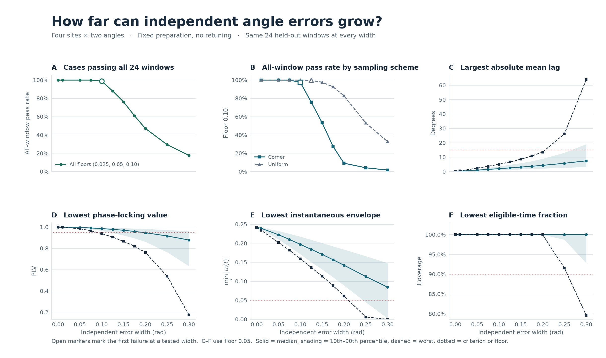
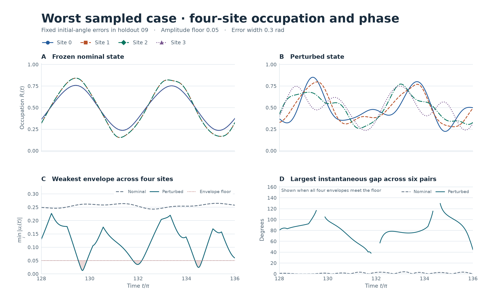
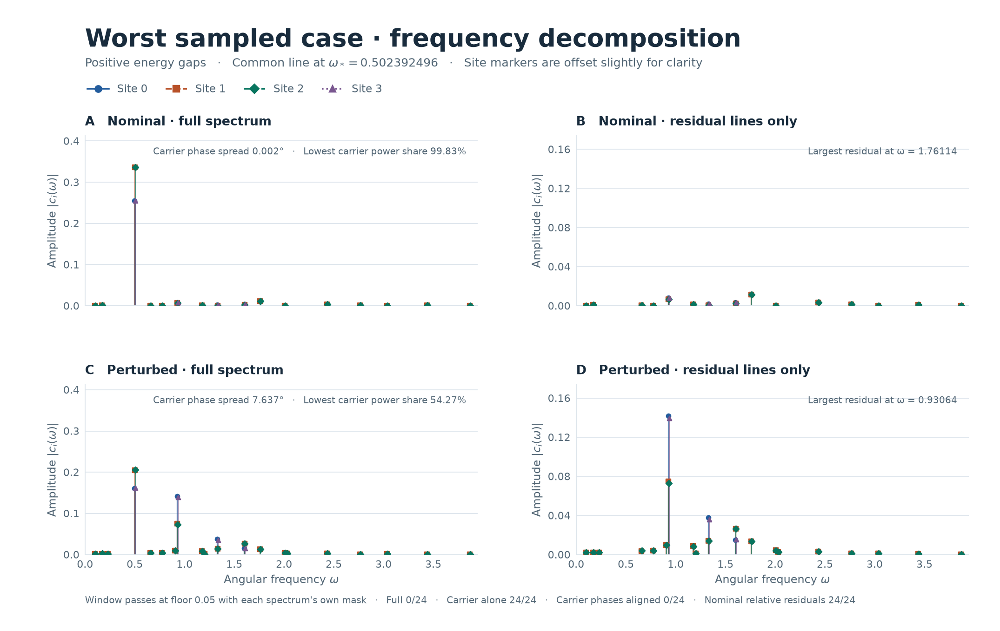

# 直線4サイトの同位相振動に対する独立な初期角度誤差

2026年11月10日。直線4サイトの時間非依存ハミルトニアン \(H=\frac12\sum_i X_i+0.35\sum_{i=0}^2 Z_i Z_{i+1}\) と、前回の主下限0.05で選ばれた純粋積状態を用いた。基準の局所角は端 \((\theta,\phi)=(1.028786494,-0.012330901)\)、内側 \((0.848414368,-0.010692994)\) rad。計算には保存済みの全精度を使用した。

## 誤差の与え方と判定

8角度に誤差を同時に加え、初期状態の再最適化は行わなかった。各半幅 \(r\) について、8成分を独立に \(\pm r\) にした頂点から鏡映を保つ16点を除いた240点と、8成分を独立に \([-r,r]\) から抽出した一様標本256点を調べた。全段階で同じ誤差方向を使用した。一様標本では実際の最大偏差 \(\lVert\delta\rVert_\infty\) は半幅より小さく、CSVには両方を記録した。頂点と一様標本の混合比率は、検証した点の中での割合である。

前回と同じ \([64\pi,256\pi]\) の幅 \(8\pi\) の24窓を使用した。各下限 \(g=0.025,0.05,0.10\) で、全サイトの占有率の半振幅が \(g\) 以上、4サイトの包絡が同時に \(g\) 以上の時刻が90%以上、その有効時刻で全6ペアの円平均位相差が \(\pm15^\circ\) 以内、PLV が0.95以上なら合格とした。閾値付近の判定は時間刻みを約0.01から0.002に細かくして再計算した。半幅の順序、候補の選び方、細分条件は [PROTOCOL.md](PROTOCOL.md) に記載した。

支配線の比較には \(\omega_*=0.502392496\) を全条件で追跡した。サイト別に複素係数の振幅・位相と、正周波数係数の二乗和に占める割合 \(\lvert c_i(\omega_*)\rvert^2/\sum_{\omega>0}\lvert c_i(\omega)\rvert^2\) を保存した。位相差はサイト番号の小さい方から大きい方を引く向き。

## 最初の不合格は ±0.10 rad の頂点で観測

**±0.01、±0.05、±0.075 rad では各496条件が、3下限すべてで24/24窓に合格した。** 初めて不合格を観測した段階は3下限とも **±0.10 rad**。鏡映を崩す頂点6条件でPLVが0.95を下回った。この段階では全条件・全窓で包絡の有効率が100%で、平均位相差と半振幅は基準内だった。一様標本での初検出は半幅0.125 radの `w0.125-u125`。実際の最大角度偏差は0.12340 rad、合格は22/24窓、最小PLVは0.94908だった。

| 誤差半幅 rad | 24窓すべて合格した頂点 / 240 | 24窓すべて合格した一様標本 / 256 | 合算の割合 | 最大平均位相差の絶対値 | 最小PLV | 最小包絡 |
|--:|--:|--:|--:|--:|--:|--:|
| 0.010 | 240 | 256 | 100% | 0.479° | 0.998816 | 0.234386 |
| 0.050 | 240 | 256 | 100% | 2.382° | 0.984502 | 0.202029 |
| 0.075 | 240 | 256 | 100% | 3.675° | 0.965375 | 0.181678 |
| 0.100 | 234 | 256 | 98.79% | 5.093° | 0.939033 | 0.159302 |
| 0.125 | 182 | 255 | 88.10% | 6.685° | 0.905865 | 0.136528 |
| 0.150 | 128 | 250 | 76.21% | 8.579° | 0.866316 | 0.113527 |
| 0.175 | 66 | 237 | 61.09% | 10.833° | 0.820847 | 0.088584 |
| 0.200 | 22 | 212 | 47.18% | 13.542° | 0.762230 | 0.061422 |
| 0.250 | 10 | 136 | 29.44% | 26.238° | 0.539045 | 0.006169 |
| 0.300 | 4 | 84 | 17.74% | 63.946° | 0.174680 | 0.000049 |

3下限で全窓合格の条件数は一致した。位相差・PLV・包絡の欄は主下限0.05における全候補・全窓の最悪値で、別の候補や窓から取ることがある。0.30 radまでに全下限で不合格が見つかったため、0.40・0.50 rad の追加段階は使わなかった。0.075 rad の全合格と0.10 rad の初検出は、試した半幅と496方向についての数値結果であり、連続した8次元領域の保証には使えない。



## 初回不合格の原因は非支配成分による位相の揺れ

初検出の6条件のうち合格窓数が最少だった代表 `w0.100-c090` の角度誤差を、サイト0から3の順に示す。

| サイト | \(\delta\theta\) rad | \(\delta\phi\) rad | 支配線の振幅 | 支配線の位相 | 支配線のパワー比 |
|--:|--:|--:|--:|--:|--:|
| 0 | −0.10 | +0.10 | 0.250962 | −179.3601° | 94.14% |
| 1 | −0.10 | +0.10 | 0.330875 | −179.0669° | 98.71% |
| 2 | +0.10 | −0.10 | 0.332090 | −178.6157° | 99.06% |
| 3 | +0.10 | −0.10 | 0.252591 | −178.5376° | 95.42% |

この方向は0.075 radでは24/24窓に合格し、最小PLVは0.965375。0.10 radでは各下限で **7/24窓**。細かい格子で最大平均位相差は5.093°、最小包絡は0.172268、4サイトの最小半振幅は0.259639、有効率100%。最も低いPLVは \([104\pi,112\pi]\)（`holdout_06`）のペア03で **0.939033** だった。

支配線だけの最大ペア位相差は0.822°。支配線の位相を揃えるようにサイトごとに解析信号全体を回しても、包絡とPLVは同じで7/24窓だった。各サイトに一定の位相を足す操作は、元の有効時刻上で円平均の向きを変え、長さであるPLVを保つ。支配線の振幅だけを基準値に戻した場合も最小PLVは0.940627、合格は11/24窓。**支配線だけを残す場合と、支配線を保って非支配成分の相対複素係数を基準値に戻す場合は、いずれも24/24窓**だった。

この誤差で特に増えたのは角周波数 **0.930636** の成分。両端の振幅は基準で各0.007996だったが、誤差後はサイト0で0.06136、サイト3で0.05340になり、この線の端同士の位相差は約162.5°だった。支配線で規格化したこの成分の複素係数差は、ペア03で0から0.4501に増えた。この成分を除くと **24/24窓** が合格し、最小PLVは0.997019。支配線とこの成分だけを残すと14/24窓、最小PLVは0.945351だった。独立誤差で両端の非支配成分が違う向きに増えたことで、端同士の相対位相が最も強く揺れた。 [初回不合格の波形](waveforms-first-failure.png) · [初回不合格のスペクトル](spectrum-first-failure.png)

## 大きい誤差では包絡低下と平均位相差も加わる

| 不合格となった指標 | 下限0.025での初検出 rad | 下限0.05での初検出 rad | 下限0.10での初検出 rad |
|:--|--:|--:|--:|
| PLV 0.95 | 0.10 | 0.10 | 0.10 |
| 平均位相差 ±15° | 0.25 | 0.25 | 0.20 |
| 包絡の有効率90% | 未検出 | 0.30 | 0.20 |
| 半振幅 | 未検出 | 未検出 | 未検出 |

振幅下限0.10で最初に有効率が不足した0.20 radでは14条件が該当した。最も有効率が低かった `w0.200-c122` は、24窓の最低有効率85.85%、最小包絡0.06142。支配線の最小振幅は0.21962で、支配線だけなら有効率100%かつ全窓合格だった。非支配成分との重ね合わせで包絡が0.10を下回った。支配線の振幅を基準に戻すと最低有効率は98.39%に回復したが、最小PLVは0.82374で全窓が未達。支配線に対する非支配成分の複素係数比を基準に戻すと、位相・振幅の両基準で24/24窓が合格した。 [有効率の初回不合格の波形](waveforms-first-coverage.png) · [同スペクトル](spectrum-first-coverage.png)

主下限0.05の全体最悪例 `w0.300-c175` は、誤差 \((\delta\theta,\delta\phi)\) がサイト0・1で \((+0.30,-0.30)\)、サイト2・3で \((+0.30,+0.30)\) rad。細かい格子で **0/24窓**、最大平均位相差63.94°、最小PLV 0.17445、最低有効率79.63%だった。基準と比べると支配線は弱くなったが、最小振幅0.16050、最大位相差7.637°で、単独なら全窓が合格する。振幅のみを基準に戻すと有効率100%に回復する一方、最小PLVは0.66053。非支配成分の相対係数を基準に戻すと、同じ支配線の振幅・位相で24/24窓が合格した。





0.30 radまでの全候補で、追跡した0.502392496は各サイトの最大成分だった。その成分だけなら、全候補で最小振幅は0.16050以上、最大のペア位相差は10.786°未満で、幅 \(8\pi\) の窓は支配線の周期より長い。観測された不合格には非支配成分の寄与が必要だった。大きい誤差では、支配線も弱まり、増えた非支配成分との干渉で振幅包絡の落ち込みが加わった。0.930636だけを除くと、有効率の初回不合格例は24/24窓、全体最悪例は20/24窓まで回復した。

支配線の位相差は、すでに大きくなった平均位相差が閾値をまたぐかどうかにも効く。例えば0.20 radの `w0.200-c175`、下限0.10、`holdout_03` のペア03では、支配線の位相を揃えると同じ有効時刻で平均位相差の絶対値が15.056°から12.066°に下がった。PLVは0.84736のままで、この窓の同位相判定は未達だった。 [不合格理由とスペクトル指標の図](failure-criteria.png)

## 再現と保存データ

このフォルダで NumPy 2 と Matplotlib を用いる。

```text
python -B sweep.py
python -B diagnostics.py
python -B plot.py
```

- [条件別CSV](case_summary.csv) は基準を含む4,961条件 × 3下限の合格数・合格率、位相・振幅指標、4サイトの支配線の振幅・位相・パワー比、実際の8角度の誤差を収録した。
- 窓別CSV `window_metrics.csv.gz`（`python -B sweep.py` で生成） は357,192行。全6ペアの符号付き平均位相差・PLV、サイト別の半振幅・最小包絡・有効率、共通有効率、不合格指標を収録した。
- [段階別集計CSV](sweep_summary.csv) と [境界の集計](sweep.json) に半幅別・標本別の合格率、各基準での初検出がある。
- [詳細スペクトルCSV](diagnostic_spectrum.csv)、[波形CSV](diagnostic_waveforms.csv)、[成分操作の全窓CSV](diagnostic_windows.csv) に、基準と代表例の周波数係数・時系列・全24窓の比較を収録した。図で用いた条件と窓は [診断条件](diagnostic_cases.json)、数値は [診断集計](diagnostics.json) にある。

基準状態の値は前回と最大 \(4.5\times10^{-15}\) 以内で一致した。スペクトル再構成と状態ベクトルの直接計算は最大 \(6.4\times10^{-13}\) 以内。判定閾値に近い2,536の条件・窓を約0.002刻みにして合否の変更はなかった。初検出の6条件、最悪例、有効率の初検出例、基準、小誤差でPLVが最も低かった例の計12条件は、約0.001刻みで従来の評価コードでも独立に照合し、全24窓・3下限の合否が一致した。
