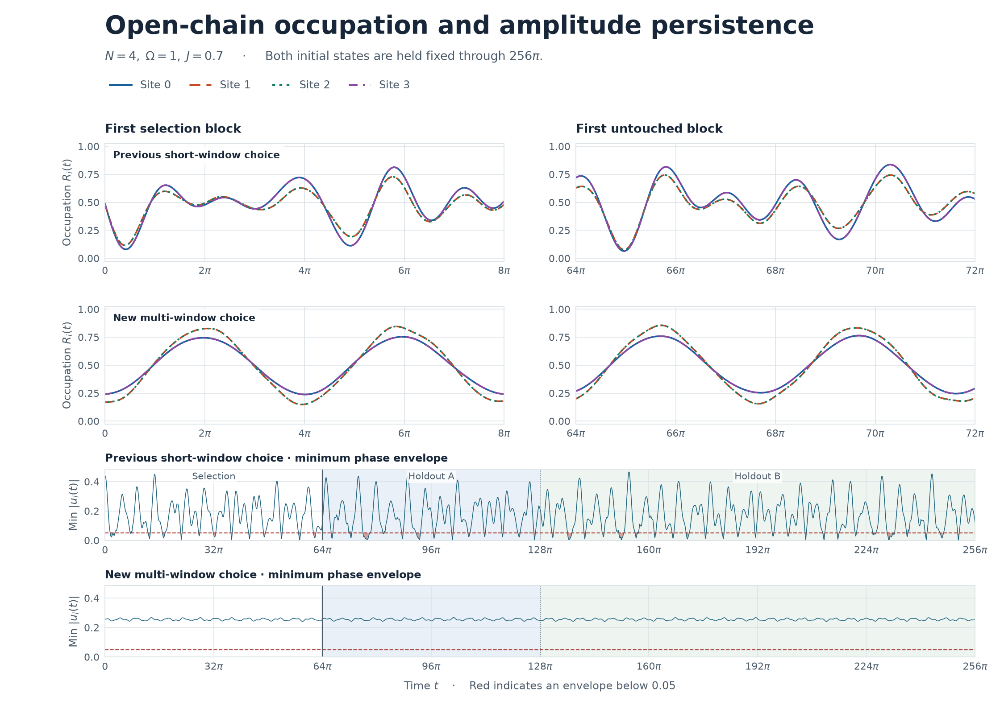
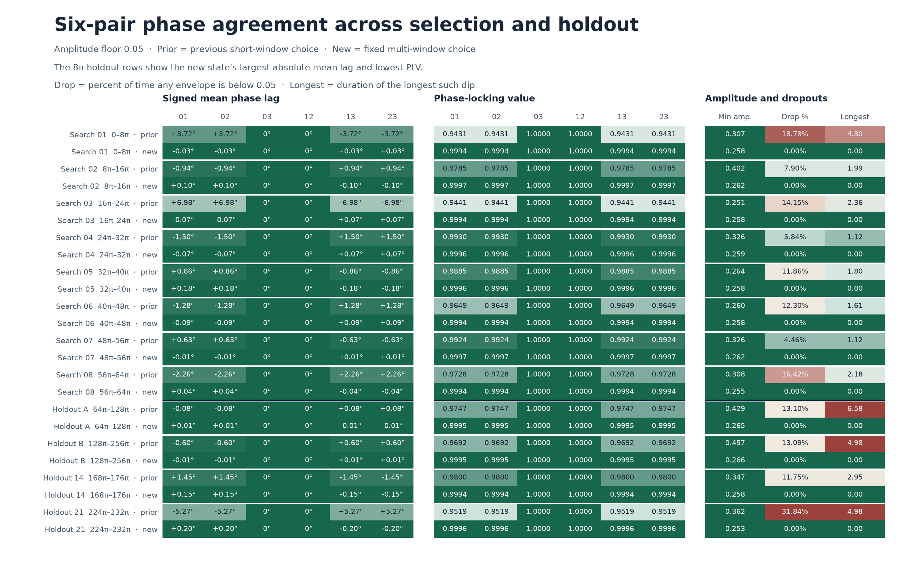

# 直線4サイトの占有率の同位相はどこまで続くか

2026年11月10日。前回と同じ直線4サイトの時間非依存ハミルトニアン \(H=\frac12\sum_{i=0}^3 X_i+\frac{0.7}{2}\sum_{i=0}^2 Z_iZ_{i+1}\) を用いた。占有率は \(R_i(t)=\langle (I-Z_i)/2\rangle_t\)。

**複数窓で選んだ積初期状態は、未使用の \(64\pi\)〜\(256\pi\) に含まれる24の検証窓すべてで合格した。** 主下限0.05では、24窓・全6ペアで平均位相差の絶対値が最大 \(0.2011^\circ\)、PLV が最小0.9993648。4サイトの瞬時包絡の最小値は0.241902で、0.05を下回る区間はなかった。同じ状態で下限0.025と0.10にも合格した。



## 選択と検証の分離

探索には \([0,64\pi]\) の幅 \(8\pi\) の8窓を使った。選択後に \([64\pi,128\pi]\) と \([128\pi,256\pi]\) の各長窓と、それらを分割した幅 \(8\pi\) の計24窓を評価した。前回の短窓 \([0,3.688]\) は比較用に再評価した。各窓は隣の窓と境界時刻を共有する。

前回と同じく、振幅下限は0.025、0.05、0.10。窓ごとの半振幅 \(A_i=(\max R_i-\min R_i)/2\) が全サイトで下限以上であり、4サイトの解析信号の包絡が同時に下限以上の時刻を90%以上必要とした。その共通時刻で \(L_{ij}=\langle e^{i(\phi_i-\phi_j)}\rangle\) を計算し、全6ペアで平均位相差 \(\arg L_{ij}\) が \(\pm15^\circ\) 以内、PLV \(|L_{ij}|\) が0.95以上なら合格。包絡下限を割る最長連続時間は、しきい値の交差を隣接サンプル間で線形補間した。Pearson相関は窓内の全サンプルから計算した。

選択は半振幅、有効率、位相差、PLV の4条件から、最も厳しい条件の余裕を8窓で最大化した。具体的な目的関数と窓は [探索前の判定条件](PROTOCOL.md) にある。短窓だけで選んだ前回の状態は、比較対象および探索の初期点に用いた。

| 候補群 | 自由角 | 球面一様 | X軸近傍を多くした点 | 6軸の組合せ |
|:--|--:|--:|--:|--:|
| 4サイト独立 | 8 | 16,384 | 8,192 | 1,296 |
| 鏡映対称 | 4 | 8,192 | 4,096 | 36 |
| 全サイト同一 | 2 | 2,048 | 1,024 | 6 |

各群に、前回の3つの短窓選択状態とスペクトル計算から得た1候補を、その群の対称性に合わせて追加した。各群・各下限の上位6候補から52ステップ局所探索し、1ステップ当たり9近傍を評価した。乱数シードは47051。時間刻みを約0.12、0.02、0.002と細かくして選択し、初期状態を [selection.json](selection.json) に保存した。検証出力には、このファイルのSHA-256を記録している。

## 選んだ積初期状態

3つの下限すべてで、端同士と内側同士が同じ状態の鏡映対称な積状態が選ばれた。主下限0.05の局所状態は \(\cos(\theta_i/2)\lvert0\rangle+e^{i\phi_i}\sin(\theta_i/2)\lvert1\rangle\)。角度はラジアンで、全精度は [selection.json](selection.json) に収録した。

| サイト | \(\theta_i\) | \(\phi_i\) |
|:--|--:|--:|
| 0, 3 | 1.028786494 | −0.012330901 |
| 1, 2 | 0.848414368 | −0.010692994 |

## 選び直さずに測った長窓の結果

主下限0.05の結果。各行の位相差とPLVは全6ペアでの最悪値、振幅は全4サイトの最小値。部分窓の行は、24窓の最悪値を指標ごとに集計している。

| 評価区間 | 最大平均位相差の絶対値 | 最小PLV | 最小半振幅 | 最小包絡 | 有効時刻 | 最長の下限割れ |
|:--|--:|--:|--:|--:|--:|--:|
| 探索8窓の最悪値 | 0.18244° | 0.9993846 | 0.25539 | 0.24191 | 100% | 0 |
| 検証 A \([64\pi,128\pi]\) | 0.01215° | 0.9995143 | 0.26518 | 0.24253 | 100% | 0 |
| 検証 B \([128\pi,256\pi]\) | 0.00900° | 0.9995174 | 0.26597 | 0.24190 | 100% | 0 |
| 検証24部分窓の最悪値 | 0.20105° | 0.9993648 | 0.25273 | 0.24190 | 100% | 0 |

検証Aの半振幅 \((A_0,A_1,A_2,A_3)\) は \((0.26518,0.35922,0.35922,0.26518)\)、Bでは \((0.26597,0.35871,0.35871,0.26597)\)。端と内側の波形には振幅の差がある。全6ペアの符号付き位相差とPLVは次のとおり。位相差の符号は \(\phi_i-\phi_j\)。

| ペア | 検証A 位相差 | 検証A PLV | 検証B 位相差 | 検証B PLV |
|:--|--:|--:|--:|--:|
| 01 | +0.01215° | 0.9995143 | −0.00900° | 0.9995174 |
| 02 | +0.01215° | 0.9995143 | −0.00900° | 0.9995174 |
| 03 | 0° | 1 | 0° | 1 |
| 12 | 0° | 1 | 0° | 1 |
| 13 | −0.01215° | 0.9995143 | +0.00900° | 0.9995174 |
| 23 | −0.01215° | 0.9995143 | +0.00900° | 0.9995174 |

検証24窓を同じ基準で比べると、前回の短窓選択は9窓、無回転の \(\lvert0000\rangle\) は3窓に合格した。前回の短窓選択から今回の状態に変えると、最大平均位相差は \(7.602^\circ\) から \(0.201^\circ\)、最小PLVは0.939657から0.999365、最も低い窓の有効率は68.14%から100%に改善した。最長の連続下限割れは6.583から0になった。最小半振幅は0.27480から0.25273に下がったが、瞬時包絡の最小値は0.000229から0.241902に上がった。旧短窓 \([0,3.688]\) だけで比べると最大位相差は \(0.0479^\circ\) から \(0.2517^\circ\) に増えた。



## 振幅下限への感度

各下限について探索窓だけで選んだ状態を評価した。3候補とも探索8窓、検証2長窓および24部分窓にすべて合格した。次の数値は検証24部分窓の最悪値。

| 下限 | 合格部分窓 | 最大平均位相差の絶対値 | 最小PLV | 最小包絡 | 最長の下限割れ |
|--:|:--:|--:|--:|--:|--:|
| 0.025 | 24/24 | 0.18998° | 0.9993688 | 0.24309 | 0 |
| 0.05 | 24/24 | 0.20105° | 0.9993648 | 0.24190 | 0 |
| 0.10 | 24/24 | 0.20144° | 0.9993728 | 0.24256 | 0 |

主下限0.05で選んだ状態を固定して他の下限を適用しても、包絡の有効率は100%で全窓に合格した。主状態の全6ペアの瞬時位相差は、探索・検証の全サンプルで同時に \(\pm30^\circ\) 以内だった。

## 持続する理由

鏡映対称性で \(R_0=R_3\)、\(R_1=R_2\) が成り立つ。端と内側の両方で共通の角周波数 \(\omega_*=0.5023924962\) が支配的で、周期は約12.5065。主状態の解析信号 \(u_i=c_i e^{i\omega_*t}+r_i(t)\) について、\(|c_i|\) は端で約0.25506、内側で約0.33624。他の周波数係数の絶対値の和 \(\rho_i\) はそれぞれ0.01328、0.02986。

三角不等式から \(|u_i(t)|\ge |c_i|-\rho_i\)。2サイトの相対位相は、共通周波数で割った後の残差の差を使って上から抑えられる。[スペクトルの検算コード](certificate.py) で求めた主状態の保守的な評価は、全時刻で包絡が **0.24178以上**、瞬時位相差が全6ペアで **6.12°以下**、任意の時間窓のPLVが **0.9943以上**。支配成分の1周期以上の窓では、占有率の半振幅も \(|c_i|-\rho_i\) 以上になる。これらの数値は、浮動小数点で求めたスペクトル係数に \(10^{-10}\) の丸め余裕を加えて不等式を評価した値。

## 再現とデータ

このフォルダで NumPy 2 と Matplotlib を用いる。

```text
python -B run.py select
python -B run.py evaluate
python -B plot.py
```

- [全35窓・全6ペアのCSV](comparison.csv) に位相差、PLV、Pearson相関、各サイトの半振幅と下限未満率がある。
- [窓別集計とスペクトルの上下界](results.json) に最長下限割れの区間、時間刻み検算、選択ファイルのハッシュがある。
- 占有率・包絡の時系列 `waveforms.csv`（`python -B run.py evaluate` で生成） は \(0\)〜\(256\pi\) を約0.02刻みで保存した。指標は約0.002刻みで求めた。

解析信号から再構成した占有率と、状態ベクトルの確率から直接計算した占有率の最大差は \(5.9\times10^{-13}\)。凍結した状態の評価を約0.001刻みにしても合否は一致した。最大平均位相差の変化は最大 \(1.5\times10^{-7}\) 度、最小PLVの変化は最大 \(2.8\times10^{-11}\)。
