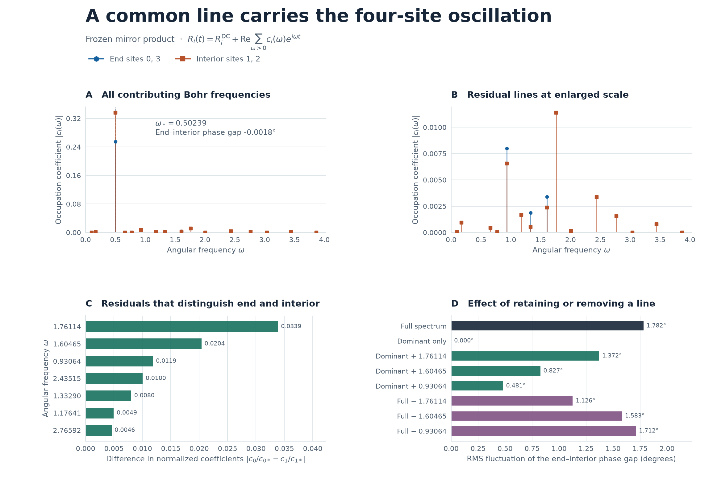
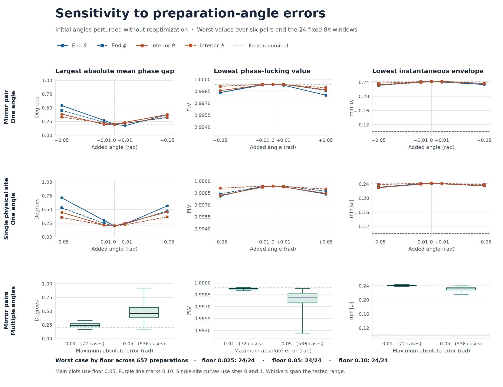

# 直線4サイトの長時間同位相振動を支える周波数と角度誤差への頑健性

2026年11月10日。直線4サイトの時間非依存ハミルトニアン \(H=\frac12\sum_i X_i+0.35\sum_{i=0}^{2}Z_i Z_{i+1}\) を用いた。基準は前回の主下限0.05で選ばれた鏡映対称な純粋積状態。保存済みの全精度の局所角を使用した。端は \((\theta,\phi)=(1.028786494,-0.012330901)\)、内側は \((0.848414368,-0.010692994)\) rad。

**共通角周波数 \(0.5023924962\) の支配で、長時間の同位相と包絡の下限を説明できる。** 非支配成分は小さいが、実波形の位相の揺れとその最大値を決める。最も大きく効くのは内側だけに現れる \(1.761139176\) の成分。鏡映を保つ角度誤差と、1サイトだけをずらす誤差を含む657条件では、再最適化せずに前回の24窓すべてで3つの振幅下限に合格した。

## 固有エネルギー差による展開

\(n_i=(I-Z_i)/2\)、\(H|a\rangle=E_a|a\rangle\)、\(s_a=\langle a|\psi_0\rangle\) とする。占有率を次の形で再構成した。

\[
R_i(t)=\tfrac12+\operatorname{Re}\sum_{\omega>0}c_i(\omega)e^{i\omega t},\qquad
c_i(\omega)=2\!\sum_{E_a-E_b=\omega}s_a^*s_b\langle a|n_i|b\rangle.
\]

グローバルな \(\prod_iX_i\) は \(H\) と可換で、\(Z_i\) の符号を反転する。\(Z_i\) の対角要素はゼロで、非定数項は反対のパリティ間の遷移から生じる。\(20H\) の偶奇パリティブロックは整数行列。既存の整数多項式と有理区間による検算を用いて、64遷移を20個の異なる正のエネルギー差へ分類した。同じ差を持つ複素係数は先に加算した。差の分類は有限時間FFTの分解能に依存せず、係数は固有ベクトルと保存済みの初期角から浮動小数点で求めた。全周波数と全サイトの複素係数は [spectrum.csv](spectrum.csv)、個別遷移は [transitions.csv](transitions.csv) にある。



## 支配線と非支配成分が抑えられる仕組み

鏡映対称性から \(R_0=R_3\)、\(R_1=R_2\)。\(\omega_*=0.5023924962\) の周期は12.5065。

| サイト | 支配線の振幅 \(\lvert c_i(\omega_*)\rvert\) | 支配線の位相 | 振動パワーの支配線比率 | 非支配振幅の総和 \(\rho_i\) | \(\rho_i/\lvert c_i(\omega_*)\rvert\) |
|:--|--:|--:|--:|--:|--:|
| 端 0, 3 | 0.255064705 | −179.223120° | 99.8786% | 0.0132761 | 5.205% |
| 内側 1, 2 | 0.336236987 | −179.221349° | 99.8261% | 0.0298587 | 8.880% |

振動パワーは周波数係数の二乗和に比例する。内側の支配線は端の1.318倍の振幅を持ち、位相差（端−内側）は \(-0.00177086^\circ\)。

端の演算子 \(Z_0\) は Majorana 演算子1個で表せる。\(A_j=(\prod_{k<j}X_k)Z_j\)、\(B_j=(\prod_{k<j}X_k)Y_j\) とすると、\(H=(i/2)A^{\mathsf T}KB\)、\(K=I-0.7L\)（\(L\) は下シフト）。\(K\) の4つの特異値が基本角周波数 \((0.50239,0.93064,1.33290,1.60465)\) を与える。端の初期 Majorana 期待値を固有モードへ射影すると、二乗ノルムの **99.8299%** が最低周波数の対に入る。端には構造上4つの基本周波数だけが現れ、そのうち3つへの射影が小さい。

内側の \(Z_1=iA_0B_0A_1\) は三次式なので、基本4本のほかに3つの異なる基本周波数の符号付き和が16通り現れ得る。このうち4本は鏡映偶の基準状態から寄与する遷移がなく、内側で観測されるのは計16本。残る非支配成分も小さい。同じ周波数に属する遷移が互いに打ち消す例もあり、内側の \(1.33290\) では遷移振幅の絶対値和0.0014361に対して、合計後の振幅は0.0005367だった。Majorana の線形・三次展開から独立に求めた係数は、固有エネルギー差による係数と \(2.8\times10^{-16}\) 以内で一致した。 [Majorana分解と選択則の検算](majorana.json)

## 同位相を支える成分と、位相の揺れを作る成分

解析信号を \(u_i(t)=c_i(\omega_*)e^{i\omega_*t}+r_i(t)\)、\(\rho_i=\sum_{\omega\ne\omega_*}|c_i(\omega)|\) とする。三角不等式だけで \(|u_i(t)|\ge |c_i(\omega_*)|-\rho_i\)。数値係数から求めた下限は端 **0.241788**、内側 **0.306378**。主周期以上の窓では占有率の半振幅にも同じ下限が成り立つ。残差による位相のずれを端と内側で別々に最大化して足すと、端と内側の瞬時位相差は **8.081°以下**、PLVは **0.990以上**と評価できる。この見積もりは異なる周波数間の打ち消しを使わず、振幅・位相・PLVの合格条件を満たす。端と内側に共通する規格化残差を差し引くと、位相差の上界は6.117°に縮む。上・下界は丸め余裕を加えた浮動小数点係数による評価。

実際の小さな位相差は、両サイトの残差を支配線で規格化して比較すると分解できる。\(d_\omega=c_0(\omega)/c_0(\omega_*)-c_1(\omega)/c_1(\omega_*)\) とすれば、端−内側の位相差の時間変動は一次近似で \(\operatorname{Im}\sum_{\omega\ne\omega_*} d_\omega e^{i(\omega-\omega_*)t}\)。24窓での一次近似誤差はRMS 0.0527°だった。

| 角周波数 | 端の振幅 | 内側の振幅 | \(\lvert d_\omega\rvert\) | 一次近似の長時間位相揺れ分散への寄与 |
|--:|--:|--:|--:|--:|
| 1.761139 | 0 | 0.011390 | 0.033874 | 59.41% |
| 1.604652 | 0.003406 | 0.002373 | 0.020410 | 21.57% |
| 0.930636 | 0.007996 | 0.006553 | 0.011863 | 7.29% |
| 2.435155 | 0 | 0.003379 | 0.010049 | 5.23% |
| 1.332896 | 0.001874 | 0.000537 | 0.008037 | 3.34% |

最大の寄与は内側に固有の三重周波数 \(1.761139=\omega_2+\omega_3-\omega_1\)（基本周波数を昇順に1〜4とした）。この線を除くと位相揺れのRMSは1.782°から1.126°に下がる。一方で \(0.930636\) を除くとRMSは1.712°に下がるが、瞬時の最大位相差は3.985°から4.456°に増える。複数の小成分の干渉は、位相揺れの細部と最大値を左右する。

| 成分を加除した解析信号 | 端−内側の位相揺れRMS | 最大瞬時位相差 | 最小包絡 | 24窓の最小PLV |
|:--|--:|--:|--:|--:|
| 全成分 | 1.782° | 3.985° | 0.241902 | 0.999365 |
| 支配線のみ | 0° | 0.00177° | 0.255065 | 1 |
| 全成分から1.761139を除去 | 1.126° | 2.882° | 0.241902 | 0.999762 |
| 全成分から0.930636を除去 | 1.712° | 4.456° | 0.249785 | 0.999379 |

各成分の加除は波形を用いた診断。角度誤差に対する以下の検証では、物理的な積初期状態を同じハミルトニアンで発展させた。 [全加除比較](mode_ablation.csv)

## 角度誤差の検証

[計算前に固定した検証条件](PROTOCOL.md) に従った。鏡映を保つ誤差では端・内側の \(\theta,\phi\) の4軸をそれぞれ \(\{-0.05,-0.01,0,0.01,0.05\}\) rad から選んだ。これに、1サイトだけの \(\theta\) または \(\phi\) を \(\pm0.01,\pm0.05\) rad ずらす32条件を追加した。角度はすべて前回の基準からの偏差。\([64\pi,256\pi]\) を幅 \(8\pi\) に分けた前回と同じ24窓で、初期状態を固定したまま評価した。

振幅下限 **0.025、0.05、0.10** を維持した。各窓の全サイトで半振幅が下限以上、4サイト共通の包絡有効率90%以上、全6ペアの円平均位相差が \(\pm15^\circ\) 以内、PLV 0.95以上が合格。**657条件すべてで、各下限とも24/24窓が合格**。下限0.10でもすべての条件で包絡有効率は100%だった。表の位相差、PLV、包絡はそれぞれの指標についての最悪値で、別々の条件・窓から取ることがある。

| 誤差条件 | 最大誤差 rad | 条件数 | 最大平均位相差の絶対値 | 最小PLV | 最小包絡 | 最悪の合格窓数（各下限） |
|:--|--:|--:|--:|--:|--:|:--:|
| 基準 | 0 | 1 | 0.201° | 0.999365 | 0.241902 | 24/24 |
| 鏡映を保ち1角だけ | 0.01 | 8 | 0.270° | 0.999263 | 0.240149 | 24/24 |
| 鏡映を保ち1角だけ | 0.05 | 8 | 0.542° | 0.998007 | 0.231340 | 24/24 |
| 鏡映を保ち複数角 | 0.01 | 72 | 0.331° | 0.999013 | 0.237933 | 24/24 |
| 鏡映を保ち複数角 | 0.05 | 536 | 0.919° | 0.993658 | 0.215882 | 24/24 |
| 1サイトの1角だけ | 0.01 | 16 | 0.301° | 0.999219 | 0.239527 | 24/24 |
| 1サイトの1角だけ | 0.05 | 16 | 0.712° | 0.998120 | 0.229645 | 24/24 |



- 最大の平均位相差と最小包絡は、\((\delta\theta_{\rm 端},\delta\phi_{\rm 端},\delta\theta_{\rm 内},\delta\phi_{\rm 内})=(-0.05,-0.05,+0.05,+0.05)\) で観測した。基準に対し、最大平均位相差は **+0.718°**、最小包絡は **−0.026020**。同じ条件で、最大瞬時位相差は3.985°から12.737°に増えた。最小PLV 0.993658は別の組合せ \((+0.05,-0.05,-0.05,+0.05)\) で、基準との差は **−0.005707**。
- 1サイトだけなら、端のサイト0の \(\theta\) を \(-0.05\) rad ずらした条件で最大平均位相差0.712°と最小PLV 0.998120を観測した。最小包絡0.229645は内側のサイト1の \(\theta\) を \(-0.05\) rad ずらしたときだった。
- 検証した全条件で、共通支配線から求めた包絡の数値下界は0.21579以上。角度誤差に対する合否は、指定した有限格子と1サイト誤差での結果。任意の連続値や、鏡映を崩す複数サイトの同時誤差は別の検証範囲になる。

## 再現と保存データ

このフォルダで NumPy 2 と Matplotlib を用いる。

```text
python -B spectrum.py
python -B majorana.py
python -B robustness.py
python -B plot.py
```

[robustness_summary.csv](robustness_summary.csv) は条件別に24窓の最悪値と基準との差を収録。[robustness_windows.csv.gz](robustness_windows.csv.gz) は展開すると、657条件 × 24窓 × 3下限の47,304行で、全6ペアの位相差・PLV・Pearson相関とサイト別半振幅・最小包絡を収録する。[robustness.json](robustness.json) と [spectral.json](spectral.json) は集計と検算の詳細。

固有エネルギー差の展開で再構成した占有率は、状態ベクトルの確率から求めた値と最大 \(2.55\times10^{-13}\) 以内で一致した。基準状態の24窓は前回と照合し、最小PLVの差は最大 \(4.5\times10^{-15}\) 以下。基準と指標別の最悪条件を合わせた22条件で、刻みを約0.002から0.001に半減しても合否は一致した。最大平均位相差の変化は \(1.7\times10^{-7}\) 度以下、最小包絡の変化は \(1.3\times10^{-8}\) 以下だった。
