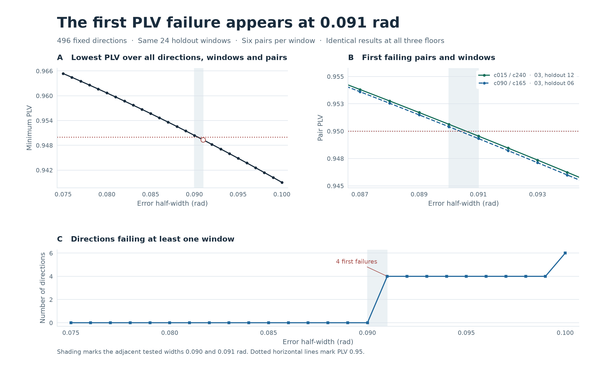
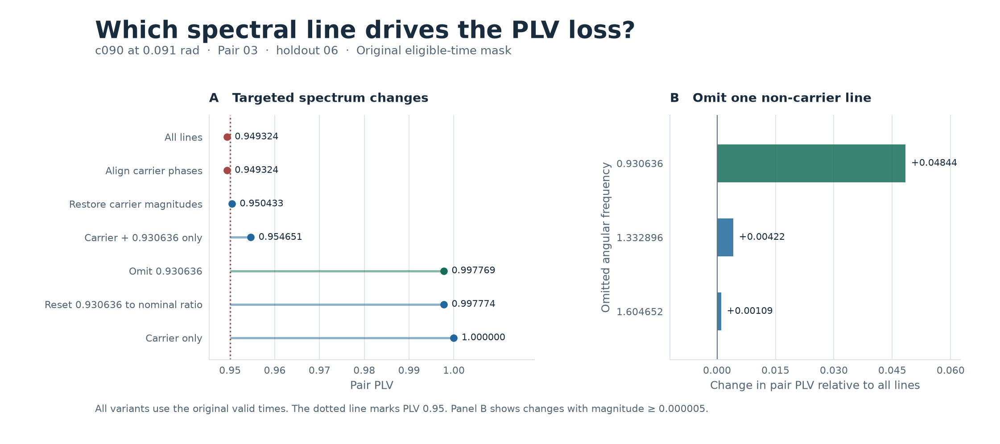

# 直線4サイトでPLVが0.95を下回る最初の誤差幅

2026年11月10日。直線の \(N=4,\Omega=1,J=0.7\) の時間非依存ハミルトニアンと、前回選んだ積初期状態の全精度の局所角を使用した。前回と同じ496方向（鏡映を崩す240頂点と一様標本256）の各方向に、誤差半幅0.075〜0.100 radを0.001 rad刻みで掛けた。再最適化は行っていない。

**0.090 radまでは全条件が合格した。0.091 radで、4方向について端同士のペア03が1窓ずつ不合格になった。** 他の492方向はその幅で全窓に合格した。振幅下限0.025、0.05、0.10で結果は一致した。

## 最初の4方向、ペア、時間窓

前回の \([64\pi,256\pi]\) の幅 \(8\pi\) の24窓をそのまま使用した。各幅・方向・窓で全6ペアの円平均位相差とPLV、4サイトの半振幅、最小包絡を計算した。全サイトで包絡が下限以上の時間が90%以上、各サイトの半振幅が下限以上、全ペアの平均位相差が \(\pm15^\circ\) 以内、PLVが0.95以上を合格とした。

| 誤差方向 | ペア | 時間窓 | PLV、0.090 rad | PLV、0.091 rad | 0.091 radの合格窓数 |
|:--|:--:|:--|--:|--:|--:|
| `c090`、`c165` | 03 | `holdout_06`、\([104\pi,112\pi]\) | 0.9504118587 | **0.9493238650** | 各23/24 |
| `c015`、`c240` | 03 | `holdout_12`、\([152\pi,160\pi]\) | 0.9506327957 | **0.9495509865** | 各23/24 |

各行の2方向は鏡映で対応し、ペア03のPLVは同じで平均位相差の符号が反転する。表は時間刻み約0.00025での値。

| 方向 | サイト0・1の \((\delta\theta,\delta\phi)\) | サイト2・3の \((\delta\theta,\delta\phi)\) |
|:--|:--|:--|
| `c090` | \((-r,+r)\) | \((+r,-r)\) |
| `c165` | \((+r,-r)\) | \((-r,+r)\) |
| `c015` | \((-r,-r)\) | \((+r,+r)\) |
| `c240` | \((+r,+r)\) | \((-r,-r)\) |

\(r\) は誤差半幅。0.091 radの不合格窓では、ペア03の平均位相差は絶対値0.836°または0.633°、共通有効率は100%だった。0.091 radの全候補・全窓の最小包絡は0.16741、最小半振幅は0.22652。3下限とも、初回不合格の指標はPLVだけだった。



## 0.930636は最大の寄与で、残る端サイトの2成分も閾値越えに効く

同じ固有エネルギー差から得た解析信号の係数を用い、0.091 radで不合格になったペア・窓を再評価した。成分の加除は診断用。PLVは元の波形と同じ有効時刻で計算した。

| 成分の操作 | `c090`・`c165` のペア03 | `c015`・`c240` のペア03 |
|:--|--:|--:|
| 全成分 | 0.949324 | 0.949551 |
| 支配線の位相を揃える | 0.949324 | 0.949551 |
| 0.930636を除く | **0.997769** | **0.997730** |
| 支配線と0.930636だけ残す | 0.954651 | 0.955004 |
| 1.332896だけ除く | 0.953545 | 0.953646 |
| 1.604652だけ除く | 0.950413 | 0.950902 |
| 支配線の振幅だけ基準値に戻す | 0.950433 | 0.950636 |

0.930636の除去は、どの非支配成分を単独で除いた場合よりも大きくPLVを回復させた。`c090` では、0.930636の端の振幅が基準の各0.007996から **0.05657、0.04829** に増え、この成分の端同士の位相差の絶対値は約162°になった。`c015` でも振幅は **0.05841、0.04562**、位相差の絶対値は約168°だった。

支配線と0.930636だけの波形は0.95以上を保つ。端に現れる小さい2成分の1.332896と1.604652が重なることで、この幅では閾値を下回った。支配線の振幅を基準値に戻しても境界のPLVがわずかに回復する。成分を残したときの位相の揺れが原因で、包絡の下限割れは全条件でなかった。0.091 radの4方向を全24窓で再評価した場合も、0.930636の除去で各23/24から24/24窓に回復した。支配線と0.930636だけの比較も全窓に合格した。 [成分操作の24窓別結果](mechanism_windows.csv)



## 数値検算と再現

全12,896状態について、支配線の振幅からその他の周波数係数の絶対値和を引いた包絡の数値下界は、全サイトで0.15829以上だった。このため振幅下限を変えても位相を計算する時刻集合は一致した。各窓の半振幅と平均位相差も全条件で基準内にあった。

主時間格子は約0.02。支配線の回転を除いた解析信号から、ペアの位相因子の二階微分を抑え、台形積分の複素平均の誤差を最大 \(6.91\times10^{-5}\) と見積もった。包絡下界と誤差評価は浮動小数点で求めたスペクトル係数に基づく。PLVが0.95から0.001以内の130条件・窓を約0.001刻みで再計算した。合否変更は0件。刻み約0.001で再計算したPLVの最小判定余裕は \(1.90\times10^{-5}\) で、この刻みの複素平均の誤差見積もり \(1.73\times10^{-7}\) を上回った。前回の0.075と0.100 radで各方向の合格窓数992件と照合し、すべて一致した。

この境界は同じ496方向と0.001 radの幅格子についての結果。角度空間全体での保証はこの検証の範囲外。

```text
python -B scan.py
python -B diagnostics.py
python -B plot.py
```

- [幅別の合格数・PLV](width_summary.csv) と [方向別の角度と指標](direction_summary.csv) に全26段階の結果を保存した。
- [最初の不合格とその直前](first_witnesses.csv)、[全不合格ペアと窓](violations.csv)、[成分操作](mechanism.csv) は境界の詳細。全条件・全窓・全6ペアの複素円平均とサイト別振幅は `python -B scan.py` が生成する `all_windows.npz` に収録する。`locking` の軸は幅、方向、窓、ペアの順で、PLVはその絶対値、符号付き平均位相差は偏角。3下限共通の値。
- [検証条件](PROTOCOL.md) と [計算の検算](scan.json) に判定方法と数値照合を収録した。
