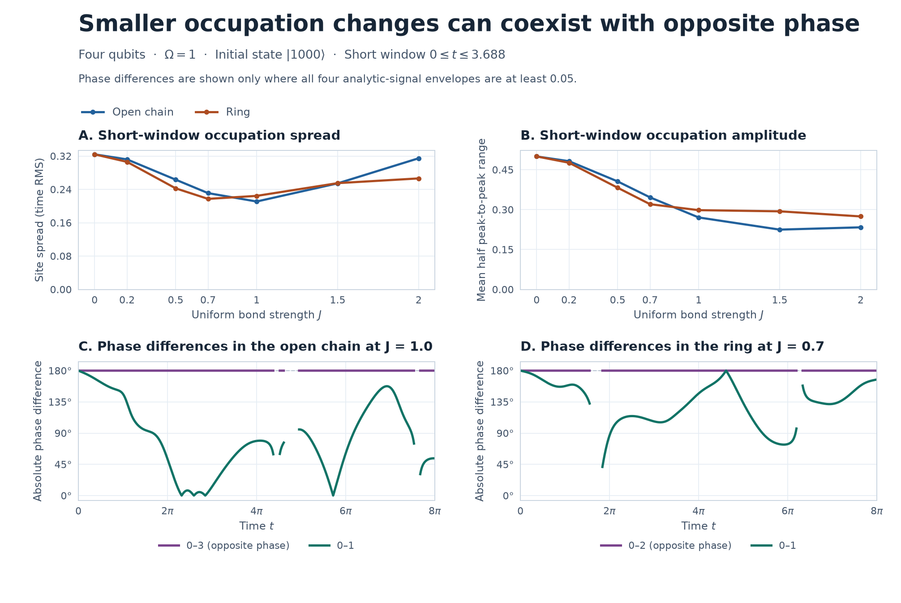

# |1000⟩ からの占有率・振幅・位相

2026年11月10日。4量子ビットの直線と輪で、横磁場 \(\Omega=1\)、初期状態 \(\lvert1000\rangle\)、一様な結合 \(J=0,\ 0.2,\ 0.5,\ 0.7,\ 1.0,\ 1.5,\ 2.0\) を比較した。直線の \(ZZ\) 結合は \(01,12,23\)、輪には \(03\) を加える。存在する結合の係数は \(J/2\)、横磁場の係数は \(\Omega/2\)。短い観測窓は前回と同じ \(0\le t\le3.688\)。全窓 \(0\le t\le8\pi\) と後半 \(4\pi\le t\le8\pi\) でも調べた。\(8\pi\) は \(J=0\) の振動4周期分。

## 指標

- **占有率のばらつき。** \(R_i=\langle(I-Z_i)/2\rangle\) とし、4サイトの標準偏差の時間RMS \(\sqrt{\langle\sum_i(R_i-\bar R)^2/4\rangle_t}\) を使う。
- **占有率の振幅。** 窓内でサイトごとの \((\max_t R_i-\min_t R_i)/2\) を求め、4サイト平均を取る。全サイトの個別値も保存した。
- **振動の位相。** ハミルトニアンの固有エネルギー差から \(R_i(t)=R_i^{\rm dc}+\operatorname{Re}u_i(t)\) を再構成する。\(u_i(t)\) は零周波数を除いた正周波数成分を2倍した解析信号で、\(\phi_i=\arg u_i\)、包絡振幅は \(|u_i|\)。有限窓のFFTは使わず、同じ解析信号を全窓で用いた。 [解析信号で位相を測った先行研究](https://journals.aps.org/prl/abstract/10.1103/PhysRevLett.76.1804)

全サイトの包絡振幅が \(0.05\) 以上の時刻を採用した。採用時刻の割合と、ペアの円平均 \(L_{ij}=\langle e^{i(\phi_i-\phi_j)}\rangle\) を保存した。\(|L_{ij}|\) は位相差の固定度（PLV）、\(\arg L_{ij}\) は平均の位相差。全サイトの同相度には \(r=|\sum_i e^{i\phi_i}|/4\) を使う。包絡の下限 \(0.025,0.10\) でも照合した。

## 4サイトの同相化を妨げる厳密な関係

\(J=0\) では \(R_0=(1+\cos t)/2\)、\(R_{1,2,3}=(1-\cos t)/2\)。全ペアのPLVは1で、サイト0は残り3サイトと逆位相。例えば \(t=\pi/2\) では4サイトの占有率がすべて \(1/2\) になる。

| 接続 | 任意の \(J,t\) で成り立つ占有率の関係 | 解析信号の関係 |
|:---|:---|:---|
| 直線 | \(R_0+R_3=1\) | \(u_0=-u_3\) |
| 輪 | \(R_0+R_2=1\)、\(R_1=R_3\) | \(u_0=-u_2\)、\(u_1=u_3\) |

逆位相のペアは、包絡振幅がある時刻に \(\pi\) だけずれる。4サイトの位相が定義できる時刻では、直線の \(r\le 1/2\)、輪の \(r=1/2\)。輪の \(1,3\) の同相関係も、初期状態を保つ反射対称性で決まる。

**直線。** マヨラナ演算子 \(a_{2j}=(\prod_{\ell<j}X_\ell)Z_j\)、\(a_{2j+1}=(\prod_{\ell<j}X_\ell)Y_j\) を使うと、\(X_j=i a_{2j}a_{2j+1}\)、\(Z_jZ_{j+1}=i a_{2j+1}a_{2j+2}\) なので \(H\) は二次式。従って \(a_0(t)=Z_0(t)\) は初期の \(a_m\) の線形結合になる。計算基底の積状態では、初期の \(\langle a_m\rangle\) は \(m=0\) のみ非ゼロ。左端の期待値は初期 \(\langle Z_0\rangle\) の符号に比例する。反射した状態で同じ議論を右端に適用すると、初期の端の符号が反対なので \(\langle Z_0(t)\rangle=-\langle Z_3(t)\rangle\)。

**輪。** 2サイト回転 \(P_2\) と計算基底での複素共役 \(K\) を用い、\(\Theta=P_2(\prod_i Z_i)X_0X_2K\) とする。\(X_0X_2\) は全結合の \(ZZ\) の符号を反転し、\(\prod_i Z_i\) は横磁場項の符号を反転するため、\(\Theta H\Theta^{-1}=-H\)。反ユニタリなので \(\Theta\) は \(e^{-itH}\) を保つ。\(\Theta\) は初期状態を全体位相まで保ち、\(Z_0\) を \(-Z_2\) に写す。従って \(\langle Z_0(t)\rangle=-\langle Z_2(t)\rangle\)。サイト0と2を固定する反射で \(R_1=R_3\) も従う。

## 短い窓のばらつきと振幅

| \(J\) | 直線のばらつき | 直線の振幅 | 輪のばらつき | 輪の振幅 |
|---:|---:|---:|---:|---:|
| 0 | 0.32409 | 0.50000 | 0.32409 | 0.50000 |
| 0.2 | 0.31204 | 0.48212 | 0.30607 | 0.47631 |
| 0.5 | 0.26343 | 0.40608 | 0.24259 | 0.38238 |
| 0.7 | 0.23108 | 0.34608 | **0.21726** | 0.32041 |
| 1.0 | **0.21094** | 0.27056 | 0.22444 | 0.29801 |
| 1.5 | 0.25450 | 0.22484 | 0.25503 | 0.29364 |
| 2.0 | 0.31472 | 0.23346 | 0.26636 | 0.27449 |

測った7点の短い窓で、占有率のばらつきが最小なのは直線の \(J=1.0\)、輪の \(J=0.7\)。両方で平均振幅も \(J=0\) より小さくなる。直線の \(J=2\) ではばらつきが対照近くに戻る一方、端の2サイトの振幅は各 \(0.107\) 程度。

| 接続と \(J\) | ペア \(01\) のPLV、短い窓 | ペア \(01\) のPLV、後半 | 後半の有効時刻 |
|:---|---:|---:|---:|
| 直線 \(J=1.0\) | 0.969 | 0.218 | 84.7% |
| 輪 \(J=0.7\) | 0.990 | 0.584 | 96.5% |

この2条件では短い窓で \(01\) の位相差が比較的集中しているが、後半ではばらつきが増える。包絡の下限を \(0.025\)〜\(0.10\) に動かしても、短い窓より後半のPLVが低い。直線 \(J=1\) では後半の採用率も下限に敏感なので、表の値と採用率を併記した。

後半の直線 \(J=0.2\) では、占有率のばらつきは \(0.0464\)、振幅は \(0.0939\)、位相を比較できる時刻は \(10.8\%\)。これは占有率が近く、振動も弱い例。全窓 \(0\)〜\(8\pi\) のばらつきの最小点は、測った7点では直線 \(J=0.7\)（\(0.15132\)）、輪 \(J=0.5\)（\(0.15790\)）。輪の \(J=0.7\) も \(0.15830\) で近い。

## 再現と照合

NumPy 2以上の環境で `python -B run.py`。固有値分解による占有率の再構成は、状態ベクトルの確率から直接計算した値と最大 \(1.8\times10^{-15}\) 以内で一致した。全ケースで占有率の補完関係と解析信号の逆符号を \(1.0\times10^{-14}\) 以内で照合した。時間刻みを約 \(0.002\) から半減したとき、占有率のばらつきは最大 \(1.8\times10^{-8}\)、平均振幅は最大 \(7.6\times10^{-8}\)、最小ペアPLVは最大 \(7.4\times10^{-4}\) 変わった。

`summary.csv` は3窓の全比較、`results.json` は全ペアのPLV・平均位相差・有効時刻の割合と下限感度、`waveforms.csv` は全窓の約 \(0.02\) 刻みの占有率・包絡振幅・位相。位相の単位はラジアン。ペアの絶対位相差は度で記録し、有効時刻以外では空欄とした。Matplotlibのある環境で `python -B plot.py` を実行すると図を再生成できる。
