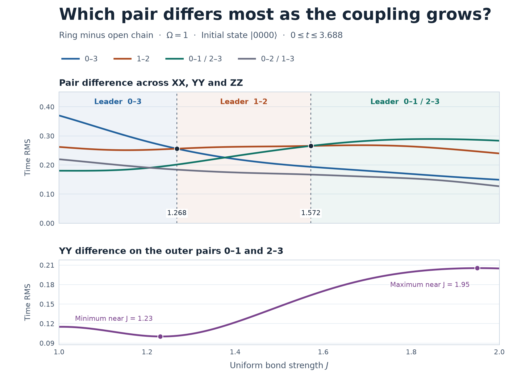

# 4量子ビットで相関差が最大のペアが切り替わる結合強度

2026年11月10日。直線と輪を同じ \(J\) で比較した。前回と同じく \(\Omega=1\)、初期状態 \(\lvert0000\rangle\)、観測区間 \(0\le t\le T=3.688\)。直線の結合は \(01,12,23\)、輪には \(03\) を加える。各枝で存在する結合の係数を一様に \(J/2\) とした。

ペアの順位は、差 \(\Delta C_{ij}^{AA}(t)=C_{ij,\mathrm{ring}}^{AA}(t)-C_{ij,\mathrm{open}}^{AA}(t)\) を用いて、各ペアの3軸を合成した時間RMSで決めた。

\[
D_{ij}(J)=\sqrt{\frac1T\int_0^T\sum_{A=X,Y,Z}\left(\Delta C_{ij}^{AA}(t)\right)^2\,dt}.
\]

反射対称性で \(D_{01}=D_{23}\)、\(D_{02}=D_{13}\) が成り立つ。外側の2ペアはそれぞれ1ペアとして順位を付けた。

## 首位は \(03\to12\to01,23\) と変わる

| \(J\) の範囲 | \(D_{ij}\) が最大のペア |
|:---|:---|
| \(1.000\) から約 \(1.26765\) | \(03\)（輪を閉じる結合） |
| 約 \(1.26765\) から約 \(1.57203\) | \(12\)（直線の中央） |
| 約 \(1.57203\) から \(2.000\) | \(01,23\)（直線の外側、同率） |

境界では隣り合う行のペアが同率。1回目の交点で共通のRMSは \(0.256011\)、2回目は \(0.265580\)。外側のペアは \(J\simeq1.37671\) で \(03\) を抜く。この時点では中央の \(12\) が \(0.261833\)、外側と \(03\) がそれぞれ \(0.225547\) で、首位は \(12\) のまま。

最初の交点までに \(03\) のRMSは \(0.370\to0.256\) に下がり、\(12\) の変化は \(0.262\to0.256\) だった。\(03\) の軸別では、特に \(XX\)（\(0.216\to0.132\)）と \(ZZ\)（\(0.289\to0.195\)）の低下が大きい。

2回目の交点での軸別RMSは次のとおり。外側ペアの \(ZZ\) の二乗差が大きく、\(XX,YY\) の二乗差が小さい分を補った。

| ペア | \(XX\) | \(YY\) | \(ZZ\) |
|:---|---:|---:|---:|
| \(01,23\)（各ペア） | 0.115469 | 0.163682 | 0.174378 |
| \(12\) | 0.127900 | 0.167821 | 0.161277 |

## 外側2ペアの \(YY\)

| \(J\) | \(YY\) 差の時間RMS（各ペア） | \(\Delta C^{YY}\) の正のピーク |
|---:|---:|---:|
| 1.00 | 0.115045 | +0.094269 |
| 1.23 | 0.100177 | +0.158093 |
| 1.50 | 0.146255 | +0.261579 |
| 1.60 | 0.169911 | +0.296115 |
| 1.80 | 0.199529 | +0.345893 |
| 1.95 | 0.205312 | +0.364453 |
| 2.00 | 0.204814 | +0.367501 |

\(YY\) 差の時間RMSは \(J\simeq1.23\) まで下がり、その後 \(J\simeq1.95\) で谷の約2倍まで増えた。\(J=2\) ではRMSがわずかに下がる一方、正のピークはさらに大きくなった。

\(J=1.50\) で正のピークを取る \(t=2.203\) では、直線と輪の \(YY\) はそれぞれ \(-0.189,\ +0.073\)。\(J=2.00\) でピークを取る \(t=1.879\) では \(-0.230,\ +0.138\)。それぞれのピーク時刻を比べると、直線はより負に、輪はより正に振れ、ピーク自体も早い時刻に移った。

## 再現と照合

NumPy 2以上の環境で `python -B run.py` を実行する。前回の固有値分解と連結相関計算を再利用した。\(J=1.00,1.01,\ldots,2.00\) の101点を調べ、交点を挟む区間で二分法を用いた。時間刻みは \(0.001\)。刻み \(0.002,0.001,0.0005\) で得た交点は、基準の \(0.001\) の値から最大 \(1.6\times10^{-7}\) 以内だった。\(J=1,2\) のペア・軸別RMSは前回の記録と一致した。

`sweep.csv` に101点の6ペアと3軸の結果、`results.json` に交点・\(YY\) の格子上の極値と数値照合を収録した。Matplotlibのある環境で `python -B plot.py` を実行すると図を再生成できる。首位の範囲と \(YY\) の時間RMSは、上で指定した観測区間での値。
