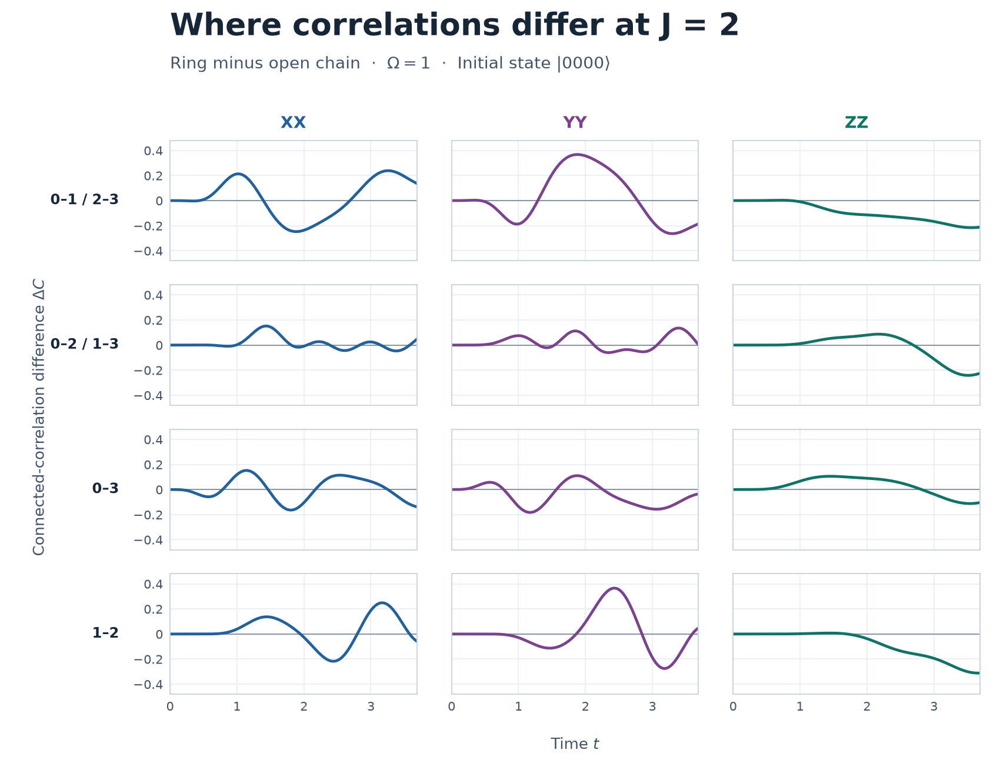

# 4量子ビットの一様結合強度と直線・輪の連結相関差

2026年11月10日。初期状態を \(\lvert0000\rangle\)、横磁場を \(\Omega=1\) とした。直線には結合 \(01,12,23\)、輪にはさらに \(03\) がある。各枝で存在するすべての結合を \(J/2\) とし、同じ \(J\) の直線と輪を比較した。時間発展中のハミルトニアンは一定で、観測区間は \(0\le t\le3.688\)。

\[
H=\frac{\Omega}{2}\sum_i X_i+\frac J2\sum_{(i,j)\,\in\,\text{結合}} Z_i Z_j,\qquad
C_{ij}^{AA}=\langle A_i A_j\rangle-\langle A_i\rangle\langle A_j\rangle,\qquad
\Delta C_{ij}^{AA}=C_{ij,\mathrm{ring}}^{AA}-C_{ij,\mathrm{open}}^{AA}.
\]

ペアと軸ごとの大きさは \(\sqrt{T^{-1}\int_0^T(\Delta C)^2\,dt}\) で比較した。合成時間RMSは18成分のRMSの二乗和の平方根。軸ごとの時間RMSはその軸に対応する6成分で同様に合成した。表の割合は、全18成分の二乗和をペアに配分した値。ピークは刻み \(0.001\) の保存点で求めた。

## 3つの結合強度

| \(J\) | 合成時間RMS | XXの時間RMS | YYの時間RMS | ZZの時間RMS | \(03\) の割合 | \(01,12,23\) の合計割合 |
|---:|---:|---:|---:|---:|---:|---:|
| 0.7 | 0.612960 | 0.353766 | 0.271491 | 0.420550 | 45.12% | 28.44% |
| 1.0 | 0.605844 | 0.339735 | 0.290833 | 0.408709 | 37.31% | 36.41% |
| 2.0 | 0.522045 | 0.273532 | 0.354133 | 0.268889 | 8.17% | 80.02% |

この3点では \(J\) を上げると合成時間RMSは下がる一方、YYの時間RMSは上がった。二乗和を最も多く占める軸は \(J=0.7,1.0\) でZZ、\(J=2.0\) でYY（46.02%）。最大のペアは \(J=0.7,1.0\) で \(03\)、\(J=2.0\) で反射対称な \(01,23\) だった。

## \(J=2\) のペア別の差

| ペア | XXの時間RMS | YYの時間RMS | ZZの時間RMS | 全18成分の二乗和に占める割合 |
|:---|---:|---:|---:|---:|
| 01、23（各ペア） | **0.155102** | **0.204814** | 0.119619 | 各29.47% |
| 02、13（各ペア） | 0.049752 | 0.058748 | 0.100803 | 各5.90% |
| 03（輪を閉じる結合） | 0.087770 | 0.096805 | 0.072138 | 8.17% |
| 12（中央の結合） | 0.118542 | 0.158867 | **0.134750** | 21.08% |

各軸で絶対値が最大になった差は以下のとおり。

| 軸 | ペア | \(t\) | 直線の \(C\) | 輪の \(C\) | \(\Delta C\) |
|:---|:---|---:|---:|---:|---:|
| XX | 12 | 3.168 | −0.114992 | +0.133875 | +0.248867 |
| YY | 01、23 | 1.879 | −0.229986 | +0.137515 | +0.367501 |
| ZZ | 12 | 3.657 | +0.363762 | +0.052266 | −0.311496 |

中央の \(12\) のZZは区間の終点 \(t=3.688\) でも差が \(-0.311062\) だった。同じ終点で \(01,23\) のYYの差は各 \(-0.185583\) で、正のピーク時から符号が変わっている。

合成距離が最大の \(t=3.301\) では、直線の占有率は端で \(0.10926\)、中央で \(0.11272\)。輪では全サイト \(0.07517\) だった。直線の端と中央の占有率差が約 \(0.00346\) の時点で、合成連結相関距離は \(0.807011\) に達した。

## 再現と照合

NumPy 2以上の環境で `python -B run.py` を実行する。16次元のハミルトニアンを固有値分解し、既存の `endpoint-field-six-qubit-2026-11-09/run.py` の連結相関計算を再利用した。`results.json` に全18成分の時間RMS、符号付きピーク、ピーク時の両枝の連結相関、区間終点の差を収録した。`waveforms.csv` には両枝の相関波形を刻み \(0.002\) で収録した。波形図を再生成するにはMatplotlibのある環境で `python -B plot.py` を実行する。

3条件で状態のノルム誤差、直線の反射・輪の回転に関する相関の対称性残差は \(1.4\times10^{-15}\) 未満。台形積分の刻みを \(0.002\) から \(0.001\) に半減して、ペア・軸ごとのRMSは最大 \(7.5\times10^{-8}\) の変化に収まった。\(J=0.7,\ t=3.462\) の合成距離は既存のTrotter計算と \(3.4\times10^{-8}\) 以内で一致した。
